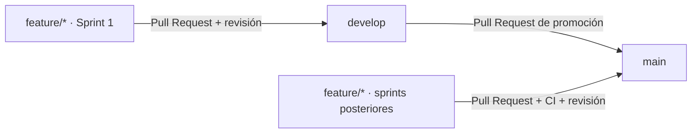

# AgroValle Connect

## Visión del Producto

Para los **productores agrícolas del Valle del Cauca** (Dagua, Palmira, Buga, Tuluá, Caicedonia, Jamundí), que necesitan **vender sus cosechas directamente a comercios urbanos sin intermediación excesiva**, AgroValle Connect es una **aplicación web empresarial (Java 17 / Spring Boot)** que **conecta en tiempo real la oferta agrícola con la demanda comercial de Cali y sus alrededores**, a diferencia de la cadena de comercialización tradicional, que **encarece el producto y perjudica tanto al productor como al comprador final**.

## Integrantes del equipo

- Juan David Gonzalez — Scrum Master
- Steven Andres Guacheta — Developer
- Andres Felipe Lopez — Developer
- Nestor Javier Hernandez — Developer

## Estrategia de ramas

El historial muestra dos etapas: al inicio, las ramas `feature/*` se integraron
en `develop` mediante Pull Requests; en los sprints posteriores, las ramas de
historias se integraron directamente en `main` mediante Pull Requests. El
workflow ejecuta CI para ambos flujos. El diagrama resume ese historial; no
define una política de ramas protegidas.

## Stack técnico

Java 17, Spring Boot, Maven, PostgreSQL.

## Calidad

- Linter: Checkstyle (`checkstyle.xml`)
- Pre-commit hook: Husky (`.husky/pre-commit`), que ejecuta `./mvnw verify`; ejecutar `npm install` para activar el hook localmente
- Integración continua: GitHub Actions (`.github/workflows/ci.yml`)
- JWT: definir `JWT_SECRET` con al menos 32 bytes antes de iniciar la aplicación; usar un secreto aleatorio fuera de pruebas y no guardarlo en el repositorio
- Recuperación de contraseña: configurar SMTP y `PASSWORD_RESET_URL` mediante variables de entorno; ver la guía de [HU-15](docs/sprint-8-hu15-recuperacion-password.md)
- Definition of Done: [`docs/dod.md`](docs/dod.md)
- Guía de ejecución y mapa de documentos: [`docs/README.md`](docs/README.md)
- Documentación integral: normalización, prototipos y arquitectura: [`docs/documentacion-integral-agrovalle.md`](docs/documentacion-integral-agrovalle.md)
- Artefactos del Sprint de Diseño: [`docs/diseno/README.md`](docs/diseno/README.md)
- Revisión de Sprint 2: [`docs/sprint-2-review.md`](docs/sprint-2-review.md)
- Sprint 6 — Inicio de sesión con JWT (HU-11): [`docs/sprint-6-hu11-login-jwt.md`](docs/sprint-6-hu11-login-jwt.md)
- Sprint 6 — Registro de comerciantes (HU-12): [`docs/sprint-6-hu12-registro-comerciantes.md`](docs/sprint-6-hu12-registro-comerciantes.md)
- Sprint 7 — Edición y baja de lotes (HU-13): [`docs/sprint-7-hu13-edicion-lotes.md`](docs/sprint-7-hu13-edicion-lotes.md)
- Evidencias y pendientes de la entrega del Segundo Corte: [`docs/entrega-segundo-corte.md`](docs/entrega-segundo-corte.md)
- Retrospectiva de Sprint 2: [`docs/sprint-2-retrospective.md`](docs/sprint-2-retrospective.md)
- Tablero Scrumban y configuración de GitHub: [`docs/scrumban.md`](docs/scrumban.md)
- Taller de integración continua de la Sesión 10: [`docs/sesion-10-integracion-continua.md`](docs/sesion-10-integracion-continua.md)
- Especificación HU-01: IEEE 29148 vs. BDD: [`docs/ieee29148-req01.md`](docs/ieee29148-req01.md)
- Backlog del producto: [`BACKLOG.md`](BACKLOG.md)
- Sprint 7 — Perfil público del agricultor (HU-14): [`docs/sprint-7-hu14-perfil-agricultor.md`](docs/sprint-7-hu14-perfil-agricultor.md)
- Sprint 8 — Recuperación de contraseña (HU-15): [`docs/sprint-8-hu15-recuperacion-password.md`](docs/sprint-8-hu15-recuperacion-password.md)
- Planificación del Sprint 1: [`docs/sprint-1-planning.md`](docs/sprint-1-planning.md)
- Planificación del Sprint 2: [`docs/sprint-2-planning.md`](docs/sprint-2-planning.md)
- Bitácora de Daily Scrums: [`docs/bitacora-daily-scrum.md`](docs/bitacora-daily-scrum.md)
- Revisión y demo del Sprint: [`docs/sprint-1-review.md`](docs/sprint-1-review.md)
- Retrospectiva del Sprint: [`docs/sprint-1-retrospective.md`](docs/sprint-1-retrospective.md)
