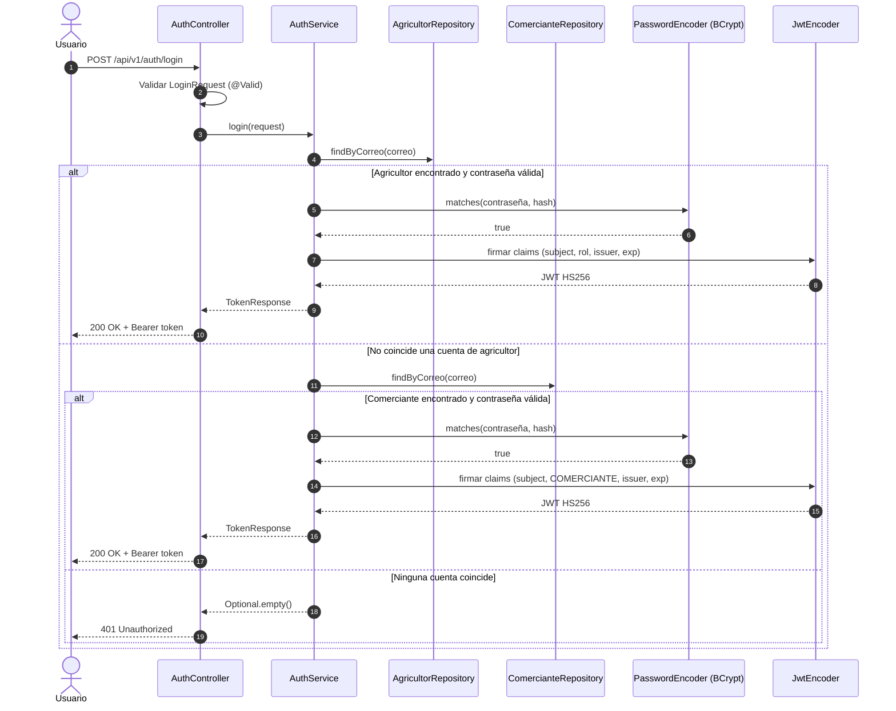
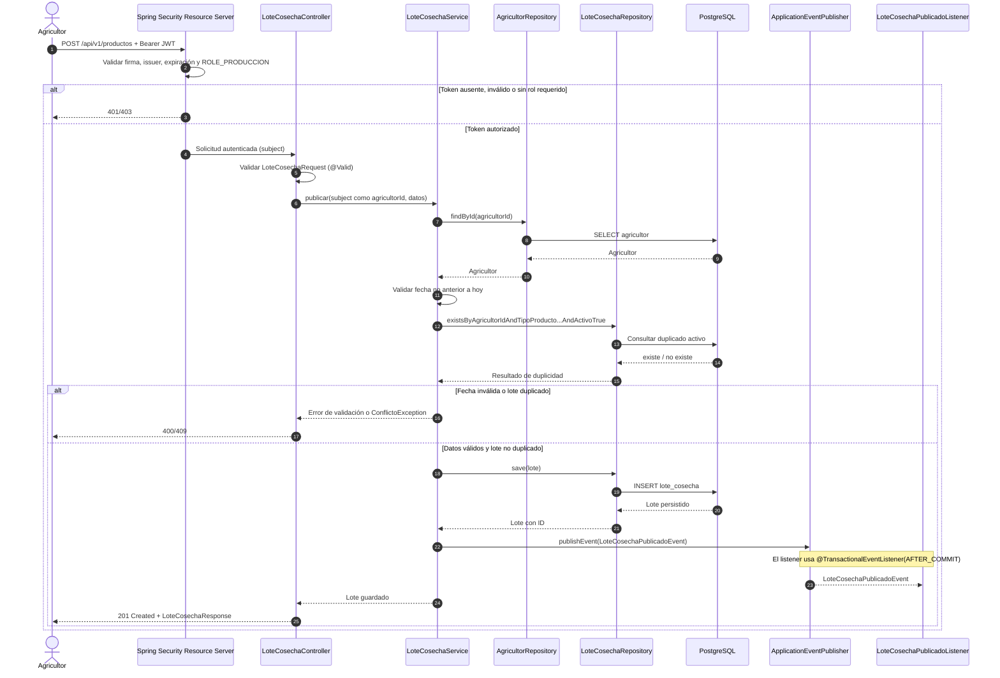
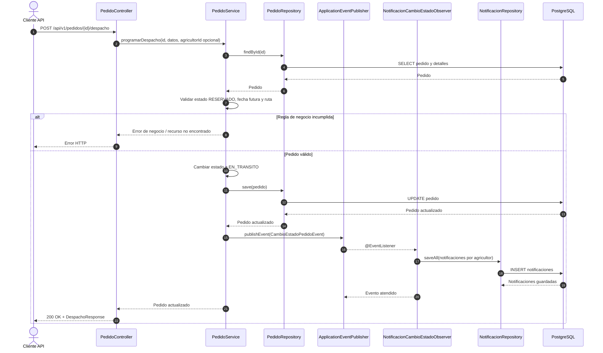
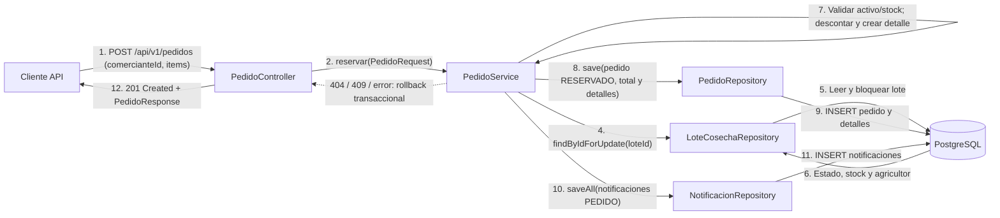
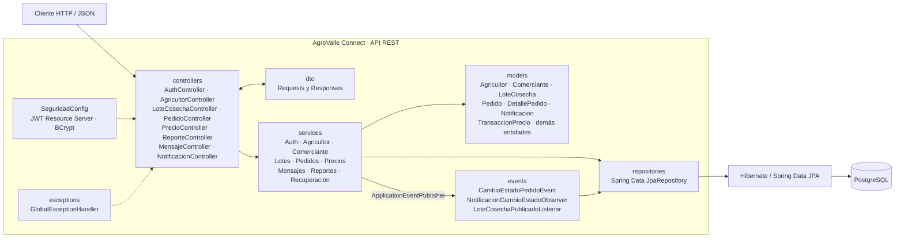
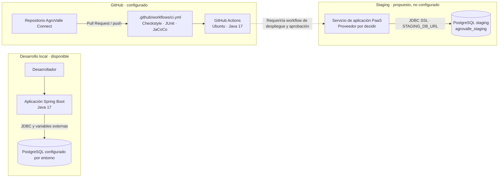

# Diagramas UML de AgroValle Connect

**Estado:** diagramas basados en el código del repositorio al 22/11/2026.
El despliegue en staging es una propuesta, no una infraestructura existente.

Este documento consolida los entregables de la Sesión 13: tres diagramas de
secuencia, dos de comunicación (colaboración), uno de componentes y uno de
despliegue. Los ejemplos de la guía se ajustaron a las clases, rutas, modelos y
configuración que realmente existen; por ejemplo, el login corresponde a HU-11,
no a HU-07, y los tokens expiran en 3600 segundos, no en 24 horas.

## 1. Secuencia: login JWT (HU-11)

`AuthController` valida la solicitud y delega en `AuthService`. El servicio
busca primero un agricultor y después un comerciante, compara la contraseña con
BCrypt y genera un JWT HS256 con `subject`, `rol`, emisor y expiración de una
hora.

La configuración real está en `AuthService`, `AuthController` y
`SeguridadConfig`; no existe un `JwtUtil` separado.

## 2. Secuencia: publicar lote autenticado (HU-02)

La seguridad exige `ROLE_PRODUCCION` para `POST /api/v1/productos`. El
controlador obtiene el ID del `subject` JWT; el servicio valida agricultor,
fecha y duplicidad antes de persistir. La publicación del evento de lote se
registra después del commit.

## 3. Secuencia: programar despacho y notificar cambio de estado

El endpoint actual es `POST /api/v1/pedidos/{id}/despacho`. Cambia un pedido
`RESERVADO` a `EN_TRANSITO`, guarda el pedido y publica
`CambioEstadoPedidoEvent`; el observer persiste una notificación para cada
agricultor asociado.

**Limitación de autorización:** en el código actual `PedidoController` recibe
`agricultorId` como parámetro opcional; no lo obtiene del principal autenticado.
Además, `SeguridadConfig` permite las demás rutas no declaradas explícitamente.
El diagrama describe el comportamiento existente, no una autorización completa.

## 4. Comunicación (colaboración): reservar pedido

Las etiquetas numeradas indican el orden de los mensajes entre objetos. El
checkout recibe `comercianteId` en el cuerpo de la solicitud; no lo deriva de
una identidad autenticada.

## 5. Comunicación (colaboración): Observer de cambios de pedido

```mermaid
flowchart LR
    Cliente["Cliente API"]
    Controller["PedidoController"]
    Service["PedidoService"]
    Orders["PedidoRepository"]
    Publisher["ApplicationEventPublisher"]
    Observer["NotificacionCambioEstadoObserver"]
    Notifications["NotificacionRepository"]
    DB[("PostgreSQL")]

    Cliente -->|"1. POST /pedidos/{id}/despacho"| Controller
    Controller -->|"2. programarDespacho(...)"| Service
    Service -->|"3. save(pedido con nuevo estado)"| Orders
    Orders -->|"4. UPDATE pedido"| DB
    Service -->|"5. publishEvent(CambioEstadoPedidoEvent)"| Publisher
    Publisher -->|"6. Notificar suscriptores @EventListener"| Observer
    Observer -->|"7. Crear una notificación por agricultor distinto"| Observer
    Observer -->|"8. saveAll(notificaciones CAMBIO_ESTADO)"| Notifications
    Notifications -->|"9. INSERT notificaciones"| DB
    Service -->|"10. Retornar Pedido actualizado"| Controller
    Controller -->|"11. 200 OK + DespachoResponse"| Cliente
```

El observer de cambios de pedido usa `@EventListener` y guarda notificaciones
en la misma operación; no envía correo ni notifica al comerciante. Es distinto
del evento de publicación de lotes, cuyo listener usa `AFTER_COMMIT`.

## 6. Componentes

Los componentes representan las clases y paquetes del backend. La base PostgreSQL
es configurable; el esquema staging no está configurado por este diagrama.

## 7. Despliegue: estado actual y staging propuesto

La línea continua representa configuración o flujo existente. La conexión
punteada es una posibilidad futura, no un despliegue realizado.

**Estado verificado:** el workflow actual solo ejecuta Checkstyle, JUnit y
JaCoCo; no hay `cd.yml`, despliegue a PaaS, perfil `application-staging.yml`,
ejecución de `schema.sql` en staging ni uso de `STAGING_DB_URL`. La decisión de
proveedor y topología está pendiente; véase el
[ADR-001 propuesto](../architecture-decisions/ADR-001-despliegue-staging-paas.md)
y la [guía de staging](../staging-preproduccion.md).

## Referencias de implementación

- [Configuración de seguridad](../../src/main/java/co/uniajc/agrovalle/agrovalleconnect/config/SeguridadConfig.java)
- [Autenticación](../../src/main/java/co/uniajc/agrovalle/agrovalleconnect/services/AuthService.java)
- [Publicación de lotes](../../src/main/java/co/uniajc/agrovalle/agrovalleconnect/services/LoteCosechaService.java)
- [Pedidos y cambios de estado](../../src/main/java/co/uniajc/agrovalle/agrovalleconnect/services/PedidoService.java)
- [Guía de staging](../staging-preproduccion.md)
