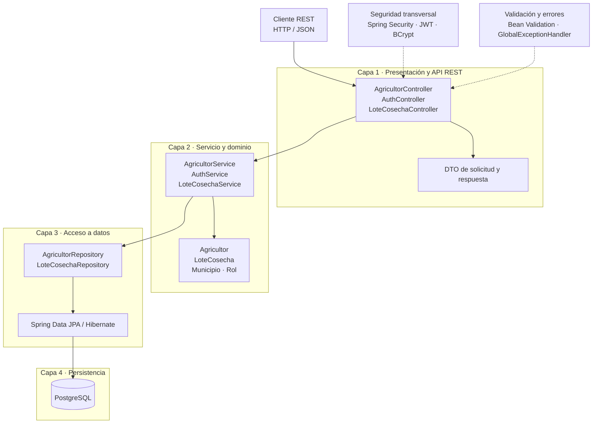

# Arquitectura MVC en cuatro capas y patrones de diseño

**Sistema:** backend REST de AgroValle Connect
**Tecnologías:** Java 17, Spring Boot, Spring MVC, Spring Security, Spring Data
JPA y PostgreSQL.

## 1. Estilo arquitectónico

El backend sigue una arquitectura MVC en capas para una API REST. No incluye
una vista web MVC: el cliente consume endpoints HTTP y envía o recibe JSON.



## 2. Responsabilidades por capa

| Capa | Paquetes y componentes | Responsabilidad | Estado |
|---|---|---|---|
| 1. Presentación / REST | `controllers`, `dto` | Recibir solicitudes, ejecutar validación de entrada, delegar al servicio y producir respuestas/códigos HTTP. | Implementada. |
| 2. Servicio / dominio | `services`, `models`, `exceptions` | Aplicar las reglas de registro, autenticación y publicación; representar entidades y errores de dominio. | Implementada para HU-01, login de soporte y HU-02. |
| 3. Repositorio / acceso a datos | `repositories` | Abstraer consultas y operaciones CRUD mediante `JpaRepository`. | Implementada para agricultor y lote. |
| 4. Persistencia / PostgreSQL | PostgreSQL, Hibernate / JPA | Guardar los datos y hacer cumplir las restricciones declaradas por las entidades y la base. | Configurada; pruebas usan H2. |

La capa 2 no define actualmente `@Transactional` en los servicios. Los métodos
de repositorio proporcionan transacciones para operaciones individuales; una
operación de negocio que coordine varias escrituras deberá delimitar su
transacción explícitamente.

## 3. Componentes y UML

Los diagramas de componentes, secuencia y despliegue se encuentran como
imágenes junto a este documento:

- `diagrama-componentes.png`
- `diagrama-secuencia-hu01.png`
- `diagrama-secuencia.png`
- `diagrama-despliegue.png`

El diagrama `diagrama-secuencia-hu01.png` documenta el registro. El diagrama
`diagrama-secuencia.png` documenta el login y la publicación autenticada del
lote (HU-02 y soporte JWT de HU-11). El flujo de registro HU-01 se describe
también en la
[documentación integral](../documentacion-integral-agrovalle.md#46-flujo-de-registro-de-agricultor).

## 4. Patrones GoF y Enterprise

| Patrón | Aplicación | Precisión sobre el estado actual |
|---|---|---|
| Repository | `AgricultorRepository` y `LoteCosechaRepository` extienden `JpaRepository`. | Implementado; Spring Data crea las implementaciones concretas. |
| Inyección de dependencias / IoC | Spring administra controladores, servicios y configuración. | Implementada con inyección por constructor en algunas clases y por campo en otras. Se recomienda uniformar por constructor. |
| Singleton (scope de Spring) | Los beans de Spring usan scope singleton por defecto. | El contenedor administra una instancia compartida por contexto; no se implementa manualmente el patrón GoF Singleton. |
| DTO | Records como `AgricultorRegistroRequest`, `LoginRequest`, `TokenResponse` y `LoteCosechaResponse`. | Implementado para delimitar contratos JSON. `AgricultorResponse` no devuelve contraseña, pero actualmente contiene cédula y correo. |
| Método fábrica estático | `AgricultorResponse.desde(...)` y `LoteCosechaResponse.desde(...)` construyen respuestas desde entidades. | Se usa un método fábrica estático como técnica de creación. No se considera el patrón GoF Factory Method: no hay creador abstracto ni jerarquía de fábricas. |
| Data Mapper | Conversión de entidad a DTO mediante `desde(...)`. | La conversión reside en el record de respuesta; no existe un Data Mapper independiente. |
| Builder | No existe un builder propio para entidades o DTO del dominio. | No está implementado ni se requiere para la construcción actual: los DTO son records y los objetos tienen pocos datos. No se incorpora solo para afirmar uso de un patrón. |

Ejemplo de Repository:

```java
public interface LoteCosechaRepository
        extends JpaRepository<LoteCosecha, Long> {
    List<LoteCosecha> findByActivoTrue();
    List<LoteCosecha> findByAgricultorIdAndActivoTrue(Long agricultorId);
}
```

Ejemplo de método fábrica del DTO:

```java
public record LoteCosechaResponse(
        Long id,
        String tipoProducto,
        Double cantidadKg,
        Double precioUnitario,
        LocalDate fechaCosecha,
        Boolean activo,
        Long agricultorId) {

    public static LoteCosechaResponse desde(LoteCosecha lote) {
        return new LoteCosechaResponse(
                lote.getId(),
                lote.getTipoProducto(),
                lote.getCantidadKg(),
                lote.getPrecioUnitario(),
                lote.getFechaCosecha(),
                lote.getActivo(),
                lote.getAgricultor().getId());
    }
}
```

## 5. Seguridad y configuración transversal

- `SeguridadConfig` define rutas públicas de login y registro, publicación de
  productos autenticada y acceso sin sesión de servidor.
- `AuthService` verifica la contraseña con BCrypt y emite un token JWT HS256 con
  una hora de duración.
- `JWT_SECRET` se inyecta desde configuración; debe tener al menos 32 bytes.
- La validación de tokens comprueba firma, expiración y emisor.
- `GlobalExceptionHandler` transforma errores de validación, JSON y persistencia
  a respuestas HTTP.
- No hay autorización por roles, ni se configura TLS o CORS en el repositorio.

Para detalles del modelo persistido, API, despliegue y trazabilidad del backlog,
consúltese la [documentación integral](../documentacion-integral-agrovalle.md).
