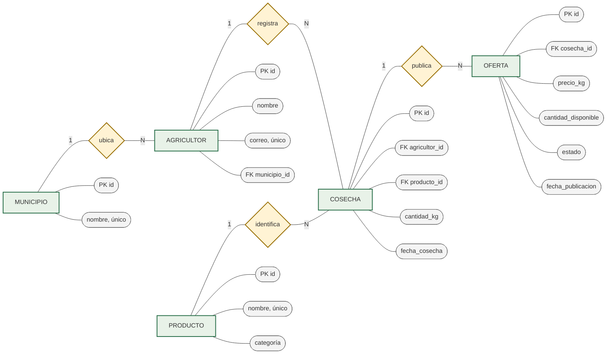

# Modelo ER canónico en notación Chen

El diagrama usa rectángulos para entidades, rombos para relaciones y óvalos
para atributos. Representa el modelo relacional canónico de cinco tablas
documentado en [modelo-datos-der.md](modelo-datos-der.md); no describe el
esquema JPA actualmente desplegado.

La cardinalidad 1:N de `COSECHA` a `OFERTA` sigue el modelo de referencia. El
esquema JPA actual agrupa atributos de cosecha y oferta en `LoteCosecha`; la
diferencia se explica en la
[correspondencia con JPA](modelo-datos-der.md#correspondencia-del-diseño-con-el-backend-jpa-actual).
