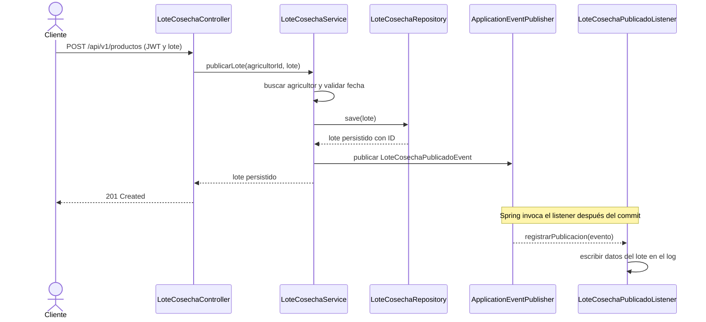

# Implementación del patrón Observer para la publicación de lotes

## Propósito

Este documento describe la implementación del patrón de comportamiento
**Observer** (Observador) en el backend de AgroValle Connect. El patrón permite
reaccionar a la publicación de un lote sin acoplar `LoteCosechaService` a las
acciones que se ejecutan como consecuencia de esa publicación.

## Necesidad de diseño

Al publicar un lote, el servicio debe persistirlo. Otras tareas, como registrar
la publicación o enviar una notificación, pueden agregarse como observadores.
Si el servicio invocara directamente cada tarea, tendría que conocer sus
implementaciones y cambiar cada vez que apareciera una nueva reacción.

La solución publica un evento de dominio con los datos mínimos necesarios.
Spring administra la distribución de ese evento a los componentes observadores.

## Componentes implementados

| Componente | Responsabilidad |
|---|---|
| `LoteCosechaService` | Valida al agricultor y la fecha, persiste el lote y publica el evento. |
| `LoteCosechaPublicadoEvent` | Transporta el identificador del lote, el identificador del agricultor y el tipo de producto. No expone la entidad JPA completa. |
| `ApplicationEventPublisher` | Contrato de Spring que desacopla al publicador de los observadores concretos. |
| `LoteCosechaPublicadoListener` | Escucha el evento después de confirmarse la transacción y registra la publicación en el log de la aplicación. |

El listener actual deja una evidencia técnica en el log. No representa todavía
una notificación visible para el agricultor ni una integración con servicios
externos.

## Flujo de ejecución

## Decisión transaccional

`publicarLote` está anotado con `@Transactional`. El evento se publica durante
la operación, pero el listener usa
`@TransactionalEventListener(phase = TransactionPhase.AFTER_COMMIT)`. Por tanto,
Spring ejecuta la reacción solo cuando la transacción terminó correctamente.
Si la transacción se revierte, el listener no se ejecuta y no registra un lote
que no haya quedado confirmado en la base de datos.

Esta solución usa eventos en memoria de Spring. No ofrece persistencia ni
reintentos del evento ante la caída del proceso después del commit; para
integraciones que requieran entrega garantizada sería necesario evaluar un
patrón como Transactional Outbox.

## Relación con Observer

- **Sujeto/publicador:** `LoteCosechaService`, mediante la abstracción
  `ApplicationEventPublisher`.
- **Evento observado:** `LoteCosechaPublicadoEvent`.
- **Observador:** `LoteCosechaPublicadoListener`.
- **Suscripción:** Spring detecta el método anotado
  `@TransactionalEventListener` y lo vincula al evento.
- **Desacoplamiento:** el servicio no importa ni invoca el listener.

Una futura notificación por correo, actualización de métricas u otra reacción
podría incorporarse como un nuevo listener sin añadir llamadas directas a
`LoteCosechaService`.

## Archivos y pruebas relacionadas

- [`LoteCosechaService.java`](../../src/main/java/co/uniajc/agrovalle/agrovalleconnect/services/LoteCosechaService.java):
  publicación transaccional del evento.
- [`LoteCosechaPublicadoEvent.java`](../../src/main/java/co/uniajc/agrovalle/agrovalleconnect/events/LoteCosechaPublicadoEvent.java):
  datos inmutables del evento.
- [`LoteCosechaPublicadoListener.java`](../../src/main/java/co/uniajc/agrovalle/agrovalleconnect/events/LoteCosechaPublicadoListener.java):
  reacción después del commit.
- [`LoteCosechaServiceTest.java`](../../src/test/java/co/uniajc/agrovalle/agrovalleconnect/services/LoteCosechaServiceTest.java):
  verifica con Mockito que se emite el evento con los datos persistidos y que
  no se emite cuando el agricultor no existe o la fecha es inválida.
- [`diagrama-componentes.svg`](diagrama-componentes.svg):
  representa el publicador y el observador en la arquitectura.

Las pruebas unitarias comprueban la emisión del evento desde el servicio con
un doble de `ApplicationEventPublisher`; no simulan un commit real ni prueban
el registro del listener en el log. La coordinación transaccional del listener
se configura mediante la anotación de Spring indicada anteriormente.
