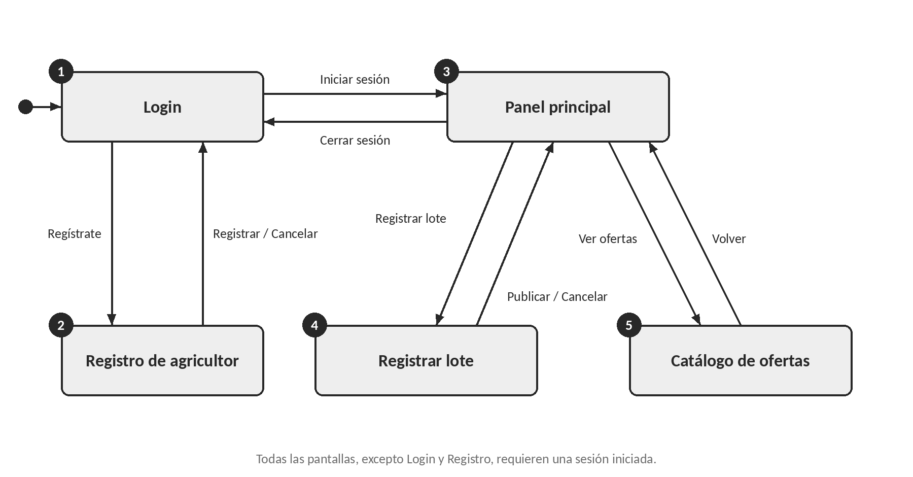
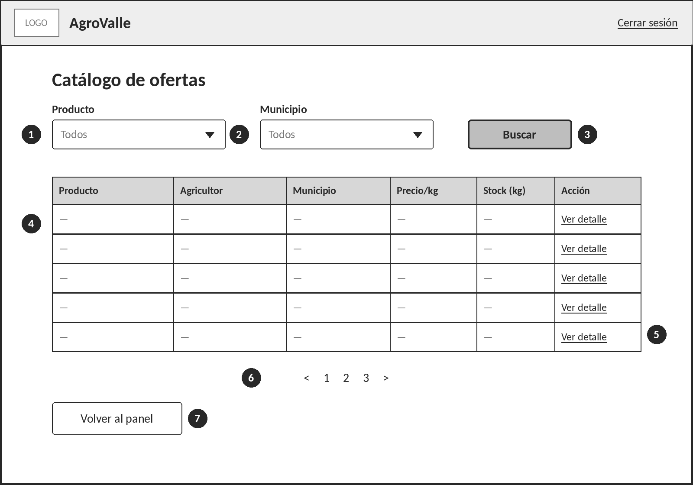
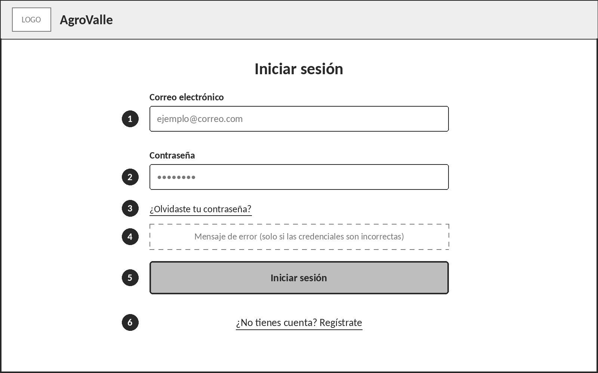
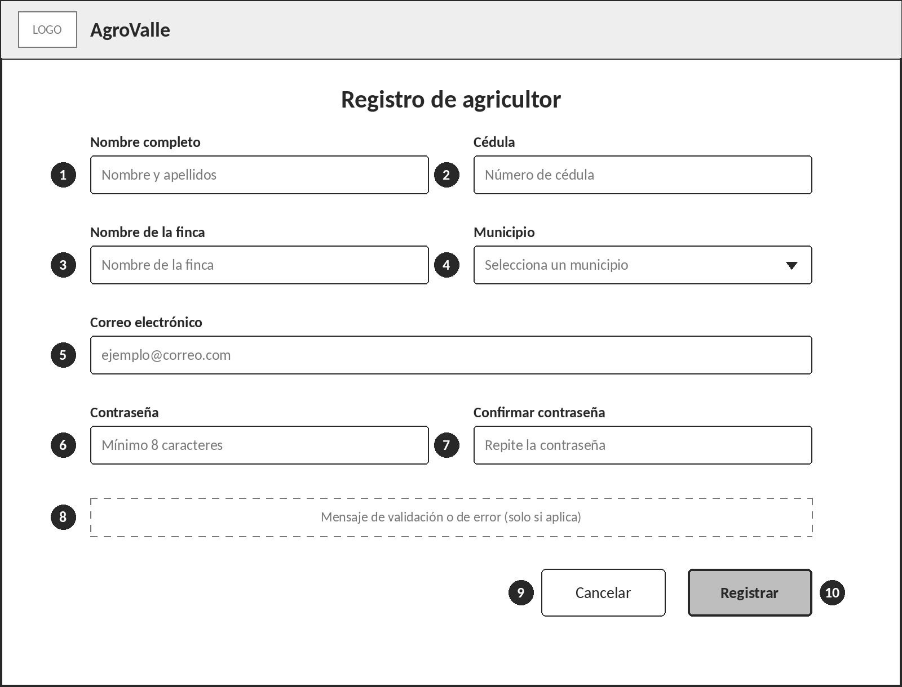
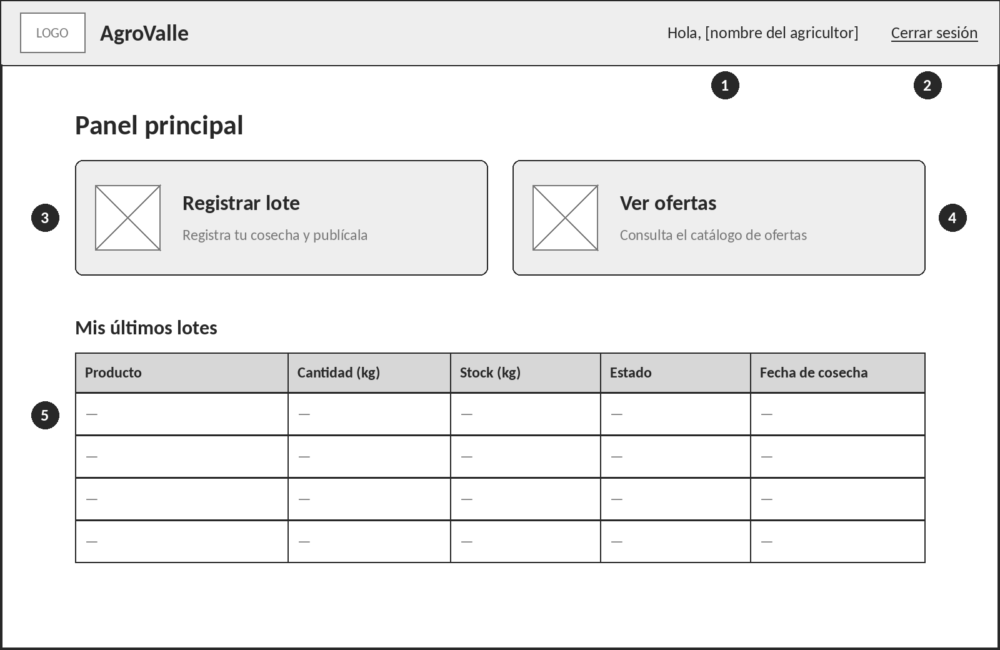
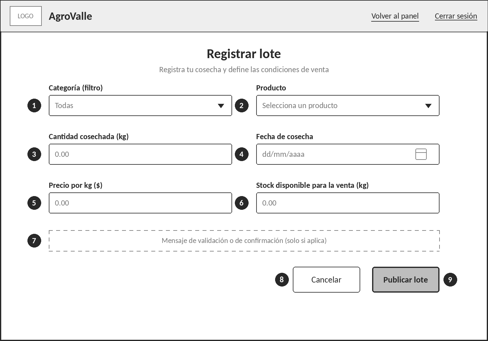

# Wireframes de baja fidelidad — módulo del agricultor

Los mockups son propuestas de interacción, no pantallas implementadas. Se
describen los campos y criterios de cada pantalla en la
[documentación integral](../documentacion-integral-agrovalle.md#3-prototipado-del-módulo-del-agricultor).

## Trazabilidad con historias, API y DTO

| Pantalla / flujo | Historia | API o DTO relacionado | Correspondencia con el backend |
|---|---|---|---|
| Login | HU-11, soporte para HU-02 | `POST /api/v1/auth/login`; `LoginRequest`, `TokenResponse` | Interfaz web conectada; solo rol `PRODUCCION` accede al panel agricultor. |
| Registro de agricultor | HU-01 | `POST /api/v1/agricultores/registro`; `AgricultorRegistroRequest`, `AgricultorResponse` | Interfaz web conectada. El backend exige cédula de 6–10 dígitos y municipio del enum; la respuesta no incluye contraseña. |
| Panel principal | HU-02 | `GET /api/v1/agricultores/{id}/perfil`; `GET /api/v1/productos/agricultor/{id}` | Interfaz muestra perfil y hasta cinco lotes activos del agricultor autenticado. |
| Registrar lote | HU-02 | `POST /api/v1/productos`; solicitud y `LoteCosechaResponse` | Interfaz conectada con JWT. El backend acepta fecha de hoy o futura y cantidad disponible igual a la cantidad cosechada. |
| Catálogo de ofertas | Evolución del producto | `GET /api/v1/productos`; `LoteCosechaResponse` | Interfaz con filtros por producto, municipio y categoría, más paginación local; solo consulta lotes activos. |

La implementación y sus diferencias respecto de los wireframes se describen en
[Interfaz web](front-end.md). La guía para ejecutar el proyecto está en
[Inicio fácil](../inicio-facil.md).

## Flujo de navegación

## Login

## Registro de agricultor

## Panel principal

## Registrar lote

## Catálogo de ofertas

