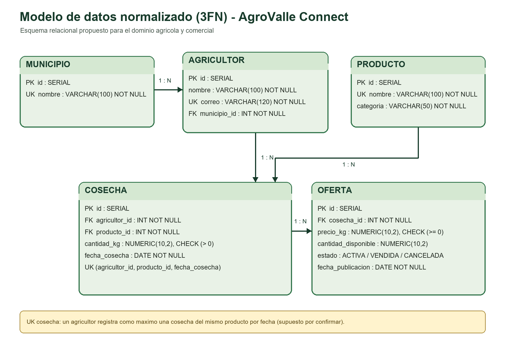
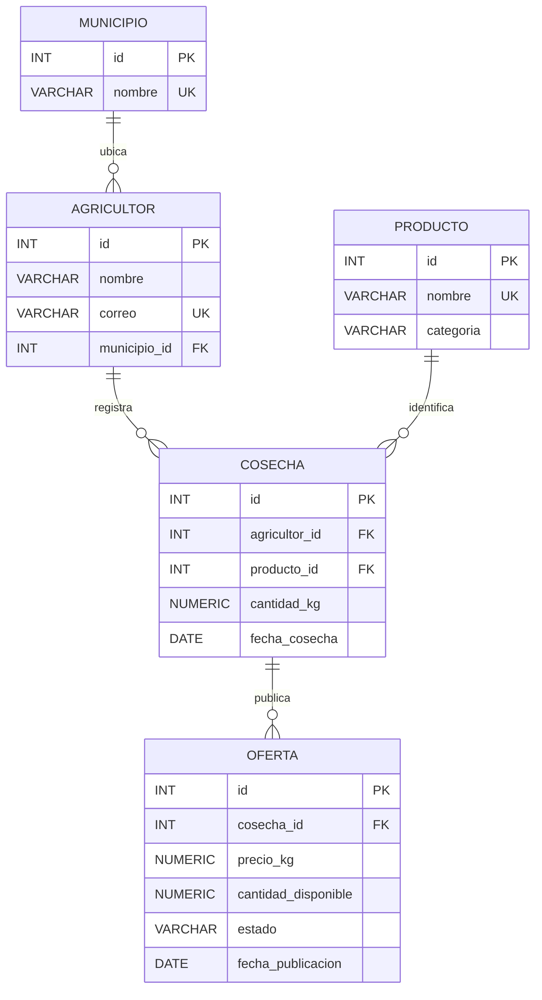

# Modelo relacional de referencia en 3FN y correspondencia con JPA

**Estado:** modelo relacional lógico de referencia para el dominio agrícola y
comercial del proyecto. El DDL PostgreSQL y el DER de cinco tablas describen el
mismo modelo. No equivalen al esquema desplegado por las entidades JPA actuales.

**Figura 1.** Modelo relacional central normalizado en 3FN, con llaves y
cardinalidades.

## Modelo entidad-relación

Este es el modelo relacional canónico de referencia en 3FN para la guía: separa
municipio, agricultor, producto, cosecha y oferta. El DDL de PostgreSQL de la
documentación integral implementa las mismas cinco tablas, relaciones y
restricciones representadas en el DER. Los nombres de las entidades y sus
atributos son coherentes entre ambos artefactos.

El criterio de negocio para la llave natural de cosecha es
`UNIQUE(agricultor_id, producto_id, fecha_cosecha)`: en este modelo un
agricultor registra como máximo una cosecha del mismo producto por fecha.
`cantidad_disponible <= cantidad_kg` debe validarse en servicio o con un
trigger, ya que la regla compara tablas distintas.

## Relaciones

| Relación | Cardinalidad | Llaves |
|---|---|---|
| Municipio–Agricultor | 1:N | `agricultor.municipio_id → municipio.id` |
| Agricultor–Cosecha | 1:N | `cosecha.agricultor_id → agricultor.id` |
| Producto–Cosecha | 1:N | `cosecha.producto_id → producto.id` |
| Cosecha–Oferta | 1:N | `oferta.cosecha_id → cosecha.id` |

## Integridad relacional

- Las llaves primarias son identificadores generados.
- `municipio.nombre`, `agricultor.correo` y `producto.nombre` son únicos.
- Las referencias `municipio_id`, `agricultor_id`, `producto_id` y `cosecha_id`
  son obligatorias.
- `cosecha.cantidad_kg` debe ser mayor que cero.
- `oferta.precio_kg` y `oferta.cantidad_disponible` no pueden ser negativos.
- `oferta.estado` se restringe a `ACTIVA`, `VENDIDA` o `CANCELADA`.
- La regla `cantidad_disponible <= cosecha.cantidad_kg` atraviesa tablas y debe
  validarse en el servicio o mediante un trigger.
- El DDL PostgreSQL completo, incluidos índices para llaves foráneas, está en
  [la sección de script de la documentación integral](../documentacion-integral-agrovalle.md#28-script-postgresql-propuesto).

## Correspondencia del diseño con el backend JPA actual

La correspondencia distingue las tablas del modelo de referencia de las clases
que existen en el código. No se afirma que una relación conceptual ya esté
implementada como entidad ni que el DDL se haya desplegado.

| Tabla de diseño | Mapeo JPA objetivo | Estado en el repositorio |
|---|---|---|
| `municipio` | Entidad `Municipio` y relación `Agricultor.municipio` con `@ManyToOne`. | La clase `Municipio` es un enum; se persiste como texto en `Agricultor`, no como tabla con FK. |
| `agricultor` | Entidad `Agricultor` con referencia a `Municipio`. | `Agricultor` existe, pero también contiene cédula, correo, contraseña codificada, teléfono y rol; el municipio es enum. |
| `producto` | Entidad `Producto`; cosecha referenciaría su ID. | No existe como entidad. `LoteCosecha.tipoProducto` es texto libre. |
| `cosecha` | Entidad `Cosecha` con relaciones a `Agricultor` y `Producto`. | No existe como entidad independiente. La información correspondiente está agrupada en `LoteCosecha`. |
| `oferta` | Entidad `Oferta` con relación a `Cosecha`. | No existe como entidad independiente. Precio y estado (`activo`) están en `LoteCosecha`. |

| Entidad JPA actual | Correspondencia con el modelo de referencia | Diferencia principal |
|---|---|---|
| `Agricultor` | `agricultor` | El backend mezcla datos personales y credenciales; municipio es enum, no FK. |
| `LoteCosecha` | Agrupa atributos de `cosecha` y `oferta` | No separa producto como catálogo ni permite varias ofertas independientes por cosecha. |
| `Municipio` (enum) | Valores del catálogo `municipio` | No se gestiona como entidad o tabla relacional. |
| `Rol` (enum) | Sin tabla equivalente en el modelo lógico de cinco tablas | Apoya la autenticación del backend actual. |

El modelo conceptual de 17 tablas y dos vistas del prototipo se conserva como
visión ampliada/hoja de ruta; no se mezcla con este DER relacional de referencia
ni con el esquema JPA actual. El modelo persistido real y sus restricciones se
describen en [Arquitectura de software implementada](../documentacion-integral-agrovalle.md#44-modelo-persistido-en-el-backend-actual).

## Diagrama ER conceptual ampliado

El prototipo también incluye un modelo conceptual de 17 tablas y dos vistas para
funcionalidades futuras (comerciantes, pedidos, logística, mensajes,
calificaciones, reportes, entre otras). Se conserva como referencia de alcance
ampliado; no forma parte del DER relacional canónico de cinco tablas ni del
alcance ejecutable del Sprint 1.

**Figura 2.** Modelo ER conceptual ampliado incluido en el prototipo.
