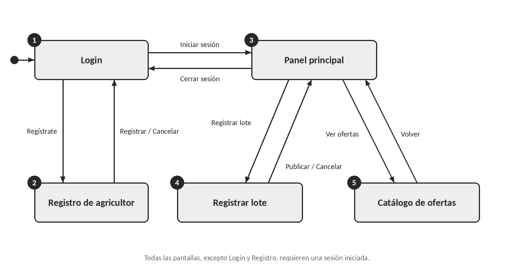
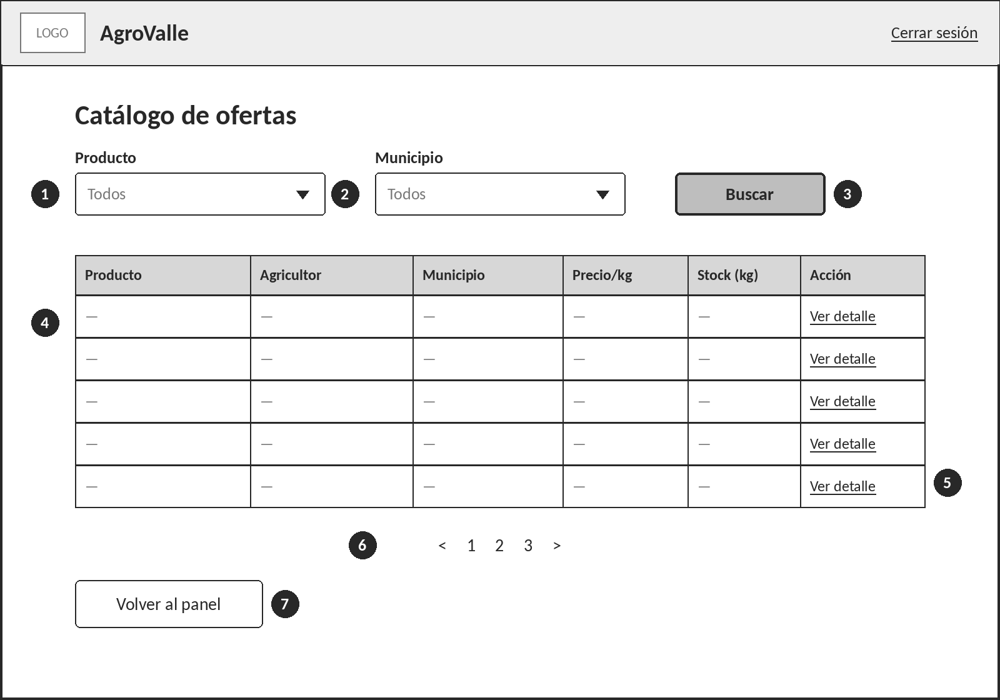
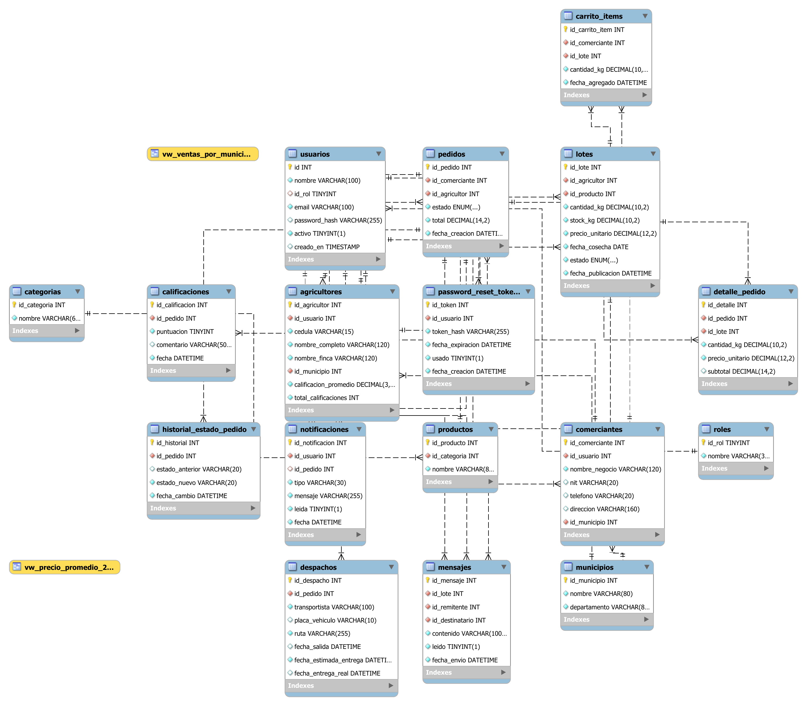
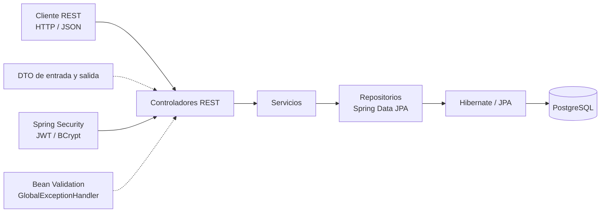
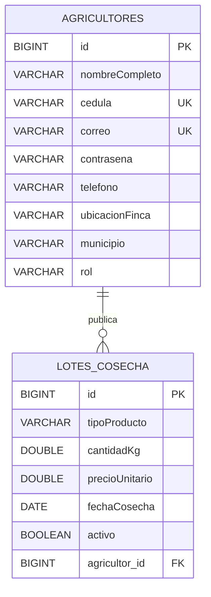
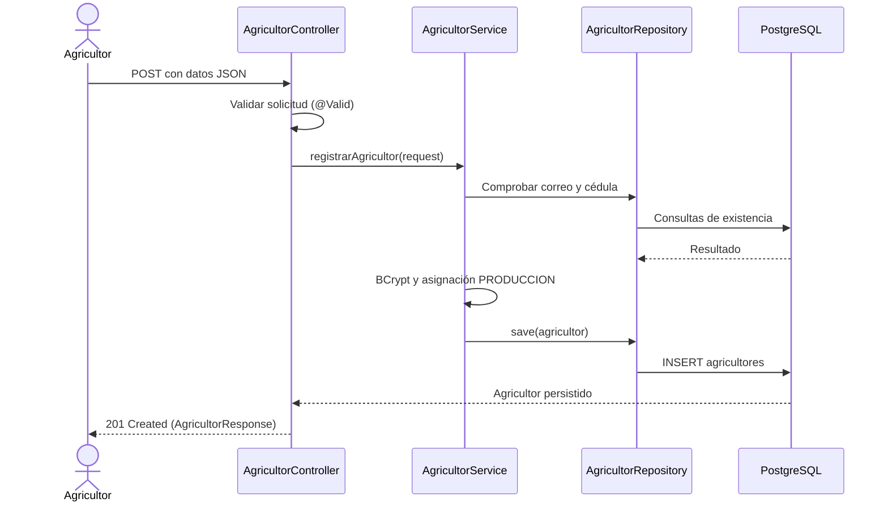
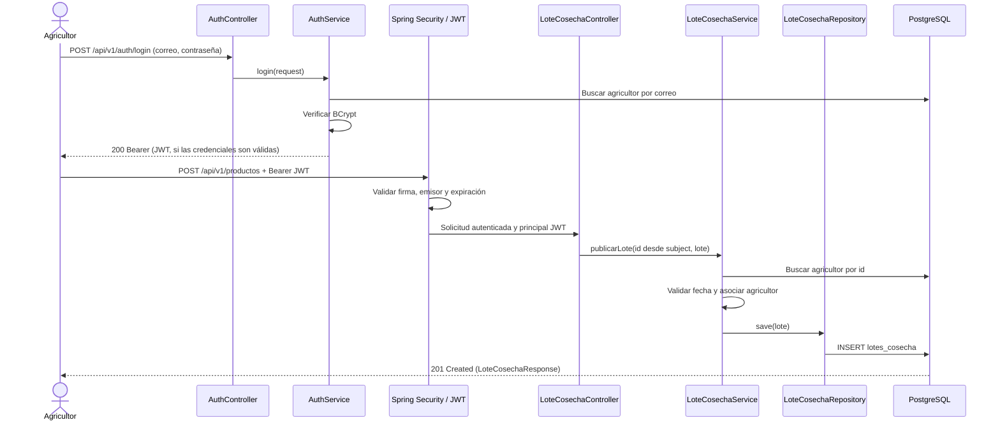
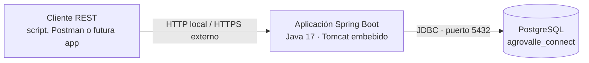

# Documentación integral de AgroValle Connect

**Curso:** Ingeniería de Software II  
**Proyecto:** AgroValle Connect  
**Repositorio:** [JD8329/Ingenieria-de-software-2](https://github.com/JD8329/Ingenieria-de-software-2)  
**Versión documental:** octubre de 2026  
**Alcance:** normalización del modelo de datos, prototipado de pantallas y arquitectura del backend.

> **Nota de alcance:** este documento reúne tres entregables con propósitos y
> niveles de diseño diferentes. La normalización y el diagrama entidad-relación
> del prototipo describen modelos conceptuales propuestos para el producto. La
> sección de arquitectura describe el código que existe actualmente en el
> repositorio. Las tablas, pantallas y capacidades futuras no deben interpretarse
> como funcionalidades implementadas.

## Contenido

1. [Objetivo y visión del producto](#1-objetivo-y-visión-del-producto)
2. [Normalización de la base de datos](#2-normalización-de-la-base-de-datos)
3. [Prototipado del módulo del agricultor](#3-prototipado-del-módulo-del-agricultor)
4. [Arquitectura de software implementada](#4-arquitectura-de-software-implementada)
5. [Alineación y decisiones pendientes](#5-alineación-y-decisiones-pendientes)
6. [Conclusiones](#6-conclusiones)

## 1. Objetivo y visión del producto

AgroValle Connect busca conectar a productores agrícolas del Valle del Cauca
(Dagua, Palmira, Buga, Tuluá, Caicedonia y Jamundí) con comercios urbanos,
reduciendo intermediarios y facilitando la consulta de la oferta de cosechas.

Este documento consolida:

- El proceso de normalización propuesto para reducir redundancia y anomalías en
  los datos.
- Los wireframes de baja fidelidad y el flujo de navegación del módulo del
  agricultor.
- La arquitectura, los endpoints, la seguridad y las pruebas verificables en el
  backend actual.

El equipo consignado en el proyecto es Juan David Gonzalez (Scrum Master),
Steven Andres Guacheta, Andres Felipe Lopez y Nestor Javier Hernandez
(Developers). El Sprint 1 comprometió HU-01 (registro de agricultores) y HU-02
(publicación de lotes), con 10 Story Points. El inicio de sesión JWT de HU-11
se implementó como soporte para la publicación autenticada.

## 2. Normalización de la base de datos

### 2.1 Propósito

El proceso parte de una estructura sin normalizar y propone un modelo relacional
en Tercera Forma Normal (3FN). Sus objetivos son reducir la redundancia, evitar
anomalías de inserción, actualización y borrado, y mantener la integridad de los
datos en PostgreSQL.

Las entidades iniciales identificadas son:

- **Municipio:** lugar de origen de los agricultores.
- **Agricultor:** persona que registra cosechas y publica productos.
- **Producto:** tipo de producto agrícola y su categoría.
- **Cosecha:** hecho agronómico que registra producto, agricultor, cantidad y
  fecha.
- **Oferta:** publicación comercial de una cosecha con precio, cantidad
  disponible y estado.

### 2.2 Punto de partida: datos sin normalizar

Si toda la información se guardara en una sola tabla, cada fila podría contener
una lista de cosechas:

| Agricultor | Correo | Municipio | Productos cosechados |
|---|---|---|---|
| Juan Pérez | juan@mail.com | Palmira | Tomate, Hortaliza, 200 kg, 2026-05-10; Cebolla, Hortaliza, 150 kg, 2026-05-12 |
| Ana Gómez | ana@mail.com | Palmira | Tomate, Hortaliza, 300 kg, 2026-05-11 |

Cuando una misma tabla almacena hechos de agricultores, productos y cosechas,
repite datos que dependen de llaves distintas. Esto genera:

- **Anomalía de inserción:** no se podría registrar un producto que aún no tenga
  cosechas, si el producto solo se representa dentro de una fila de cosecha.
  También sería difícil registrar municipios sin agricultores.
- **Anomalía de actualización:** el municipio de un agricultor aparecería en
  cada una de sus filas. Un cambio incompleto dejaría valores contradictorios.
- **Anomalía de borrado:** al eliminar la única cosecha de un producto podrían
  perderse también los datos del producto y su categoría. Al eliminar la última
  cosecha de un agricultor se podrían perder sus datos personales.

### 2.3 Primera Forma Normal (1FN)

Una relación está en 1FN cuando cada celda contiene un valor atómico, no existen
grupos repetidos y cada fila se identifica de forma única.

La columna “productos cosechados” viola la 1FN porque agrupa varios valores.
La solución propuesta es almacenar una fila por cosecha:

| correo (PK) | producto (PK) | fecha_cosecha (PK) | nombre | municipio | categoria | cantidad_kg |
|---|---|---|---|---|---|---:|
| juan@mail.com | Tomate | 2026-05-10 | Juan Pérez | Palmira | Hortaliza | 200 |
| juan@mail.com | Cebolla | 2026-05-12 | Juan Pérez | Palmira | Hortaliza | 150 |
| ana@mail.com | Tomate | 2026-05-11 | Ana Gómez | Palmira | Hortaliza | 300 |

La llave primaria compuesta propuesta es
`(correo, producto, fecha_cosecha)`. Esta decisión supone que un agricultor no
registra dos cosechas del mismo producto en la misma fecha; es un supuesto de
negocio que debe confirmarse.

Una dependencia funcional `X → Y` indica que el valor de `X` determina un único
valor de `Y`. En la tabla anterior:

- `(correo, producto, fecha_cosecha) → {nombre, municipio, categoria, cantidad_kg}`
- `correo → nombre, municipio`
- `producto → categoria`

El nombre y el municipio dependen solo del correo, y la categoría depende solo
del producto. Estas dependencias parciales causan redundancia.

### 2.4 Segunda Forma Normal (2FN)

Una relación está en 2FN cuando está en 1FN y todo atributo no llave depende de
la llave completa, no solo de una parte de una llave compuesta.

| Dependencia funcional | Tipo | Justificación |
|---|---|---|
| `correo → nombre, municipio` | Parcial | El nombre y el municipio del agricultor no dependen del producto ni de la fecha. |
| `producto → categoria` | Parcial | La categoría es una propiedad del producto. |
| `(correo, producto, fecha_cosecha) → cantidad_kg` | Total | La cantidad pertenece a una cosecha específica. |

La descomposición propuesta es:

- `AGRICULTOR(correo, nombre, municipio)`, con `correo` como llave.
- `PRODUCTO(producto, categoria)`, con `producto` como llave.
- `COSECHA(correo, producto, fecha_cosecha, cantidad_kg)`, con llave compuesta
  `(correo, producto, fecha_cosecha)` y llaves foráneas a agricultor y producto.

La descomposición es sin pérdida según el documento fuente: las intersecciones
entre las tablas contienen las llaves de `AGRICULTOR` y `PRODUCTO`, y las
dependencias se conservan en las relaciones resultantes.

### 2.5 Tercera Forma Normal (3FN)

Una relación está en 3FN cuando está en 2FN y ningún atributo no llave depende
transitivamente de la llave. En el esquema obtenido en 2FN, los determinantes
son llaves, por lo que no se identifican dependencias transitivas con los
atributos descritos. Las decisiones siguientes son de consistencia y evolución
del modelo, no correcciones de una dependencia transitiva existente:

- **Municipio como entidad:** evita variantes textuales como “Palmira”,
  “palmira” o “Palmira ”. También permite añadir atributos del municipio, como
  el departamento.
- **Oferta separada de cosecha:** separa el hecho agronómico de la decisión
  comercial. Una cosecha puede tener ofertas con distintos precios o cancelarse
  y publicarse de nuevo; precio y estado dependen de la oferta.
- **Llaves sustitutas:** identificadores numéricos simplifican llaves foráneas y
  el mapeo a JPA. Se conservan restricciones `UNIQUE` para correo, nombres de
  municipio y producto, y para la combinación natural de cosecha.

Dependencias funcionales y llaves candidatas propuestas:

| Tabla | Dependencias funcionales | Llaves candidatas |
|---|---|---|
| `municipio` | `id → nombre` | `id`, `nombre` |
| `agricultor` | `id → nombre, correo, municipio_id` | `id`, `correo` |
| `producto` | `id → nombre, categoria` | `id`, `nombre` |
| `cosecha` | `id → agricultor_id, producto_id, cantidad_kg, fecha_cosecha` | `id`, `(agricultor_id, producto_id, fecha_cosecha)` |
| `oferta` | `id → cosecha_id, precio_kg, cantidad_disponible, estado, fecha_publicacion` | `id` |

La categoría permanece como texto en `PRODUCTO`, porque depende del producto. Si
se necesita un catálogo de categorías controlado o con atributos propios, se
puede normalizar en una entidad `CATEGORIA`.

### 2.6 Modelo relacional propuesto

| Tabla | Llave primaria | Atributos y restricciones propuestas | Llaves foráneas |
|---|---|---|---|
| `municipio` | `id` | `nombre NOT NULL UNIQUE` | — |
| `agricultor` | `id` | `nombre NOT NULL`; `correo NOT NULL UNIQUE`; `municipio_id NOT NULL` | `municipio_id → municipio(id)` |
| `producto` | `id` | `nombre NOT NULL UNIQUE`; `categoria NOT NULL` | — |
| `cosecha` | `id` | `cantidad_kg NOT NULL CHECK (> 0)`; `fecha_cosecha NOT NULL`; `UNIQUE(agricultor_id, producto_id, fecha_cosecha)` | `agricultor_id → agricultor(id)`; `producto_id → producto(id)` |
| `oferta` | `id` | `precio_kg NOT NULL CHECK (>= 0)`; `cantidad_disponible NOT NULL CHECK (>= 0)`; estado restringido; `fecha_publicacion NOT NULL DEFAULT CURRENT_DATE` | `cosecha_id → cosecha(id)` |

Cardinalidades:

| Entidad origen | Entidad destino | Cardinalidad | Descripción |
|---|---|---|---|
| Municipio | Agricultor | 1:N | Un municipio tiene varios agricultores; cada agricultor pertenece a un municipio. |
| Agricultor | Cosecha | 1:N | Un agricultor registra varias cosechas; cada cosecha pertenece a un agricultor. |
| Producto | Cosecha | 1:N | Un producto puede aparecer en varias cosechas; cada cosecha corresponde a un producto. |
| Cosecha | Oferta | 1:N | Una cosecha puede publicarse en varias ofertas; cada oferta corresponde a una cosecha. |

### 2.7 Restricciones y mejoras propuestas

- Mantener `UNIQUE(agricultor_id, producto_id, fecha_cosecha)` conserva la llave
  natural supuesta para cosechas.
- Los nombres de municipio y producto deben ser únicos.
- Las llaves foráneas y campos obligatorios deben usar `NOT NULL` donde aplique.
- `CHECK` puede validar cantidades y precios y restringir estados a un conjunto
  cerrado.
- Se propone `NUMERIC(10,2)` para cantidades y precios en lugar de punto
  flotante, especialmente para valores monetarios.
- PostgreSQL no crea automáticamente índices para llaves foráneas; se proponen
  índices explícitos para consultas y validaciones de integridad.
- La regla “la cantidad disponible no supera la cantidad cosechada” involucra
  dos tablas y no puede expresarse con un `CHECK` simple; debe validarse en la
  capa de servicios o mediante un trigger.
- `SERIAL` es válido; `GENERATED ALWAYS AS IDENTITY` es una alternativa para
  PostgreSQL 10 o superior.

### 2.8 Script PostgreSQL propuesto

> Este script pertenece al modelo normalizado conceptual. No representa el
> esquema que actualmente crean las entidades JPA del backend.

```sql
-- Script de creación: Proyecto AgroValle (PostgreSQL 10 o superior)
-- Primero se crean las tablas referenciadas y luego las dependientes.
CREATE TABLE municipio (
    id     SERIAL PRIMARY KEY,
    nombre VARCHAR(100) NOT NULL UNIQUE
);

CREATE TABLE agricultor (
    id           SERIAL PRIMARY KEY,
    nombre       VARCHAR(100) NOT NULL,
    correo       VARCHAR(120) NOT NULL UNIQUE,
    municipio_id INT NOT NULL REFERENCES municipio(id)
);

CREATE TABLE producto (
    id        SERIAL PRIMARY KEY,
    nombre    VARCHAR(100) NOT NULL UNIQUE,
    categoria VARCHAR(50) NOT NULL
);

CREATE TABLE cosecha (
    id            SERIAL PRIMARY KEY,
    agricultor_id INT NOT NULL REFERENCES agricultor(id),
    producto_id   INT NOT NULL REFERENCES producto(id),
    cantidad_kg   NUMERIC(10,2) NOT NULL CHECK (cantidad_kg > 0),
    fecha_cosecha DATE NOT NULL,
    CONSTRAINT uq_cosecha_natural
        UNIQUE (agricultor_id, producto_id, fecha_cosecha)
);

CREATE TABLE oferta (
    id                  SERIAL PRIMARY KEY,
    cosecha_id          INT NOT NULL REFERENCES cosecha(id),
    precio_kg           NUMERIC(10,2) NOT NULL CHECK (precio_kg >= 0),
    cantidad_disponible NUMERIC(10,2) NOT NULL
        CHECK (cantidad_disponible >= 0),
    estado              VARCHAR(20) NOT NULL DEFAULT 'ACTIVA'
        CHECK (estado IN ('ACTIVA', 'VENDIDA', 'CANCELADA')),
    fecha_publicacion   DATE NOT NULL DEFAULT CURRENT_DATE
);

-- PostgreSQL no crea índices automáticamente para las llaves foráneas.
CREATE INDEX idx_agricultor_municipio ON agricultor(municipio_id);
CREATE INDEX idx_cosecha_agricultor   ON cosecha(agricultor_id);
CREATE INDEX idx_cosecha_producto     ON cosecha(producto_id);
CREATE INDEX idx_oferta_cosecha       ON oferta(cosecha_id);
```

### 2.9 Conclusiones de la normalización

El modelo propuesto separa los hechos de municipio, agricultor, producto,
cosecha y oferta para que cada dato se almacene en un lugar coherente. Las
llaves primarias y foráneas, las restricciones `UNIQUE`, `NOT NULL` y `CHECK`,
y los índices propuestos contribuyen a la integridad y al rendimiento. La regla
que compara cantidades entre tablas debe implementarse en el backend o mediante
un mecanismo adicional de base de datos.

**Referencias**

- Codd, E. F. (1970). “A relational model of data for large shared data banks”.
  *Communications of the ACM, 13*(6), 377–387.
  <https://doi.org/10.1145/362384.362685>
- Elmasri, R. y Navathe, S. B. (2016). *Fundamentals of Database Systems*
  (7.ª ed.). Pearson.
- PostgreSQL Global Development Group. *PostgreSQL documentation*.
  <https://www.postgresql.org/docs/>

## 3. Prototipado del módulo del agricultor

### 3.1 Objetivo y alcance

Los wireframes de baja fidelidad definen la estructura, los campos y la
navegación del módulo del agricultor antes del diseño visual final y la
implementación. Se derivan del modelo conceptual del prototipo; por ello, las
referencias a tablas como `usuarios`, `categorias`, `productos` o
`password_reset_tokens` no implican que esas tablas existan en el backend actual.

El prototipo incluye cinco pantallas:

1. Login.
2. Registro de agricultor.
3. Panel principal.
4. Registrar lote.
5. Catálogo de ofertas.

El formulario Registrar lote reúne el registro de la cosecha y su publicación
comercial. El diseño plantea que cosecha y oferta se almacenan juntas en la
tabla `lotes`.

El alcance visual no incluye las pantallas del comerciante (carrito y pedidos),
despachos, calificaciones, mensajes, notificaciones, recuperación de contraseña
ni detalle del lote. Se prevén para una iteración posterior.

### 3.2 Criterios de diseño

| Criterio | Aplicación |
|---|---|
| Baja fidelidad | Escala de grises, cajas y texto de ejemplo; no define colores, iconos finales o fotografías. |
| Estructura común | Barra superior con logo, nombre del sistema y opciones de sesión; contenido central consistente. |
| Campos de formulario | Etiqueta encima del campo y texto de ejemplo dentro de la caja. |
| Jerarquía de botones | Acción principal rellena en gris; acción secundaria blanca con borde. |
| Listas desplegables | Indicadas con flecha; sus opciones provienen de catálogos previstos. |
| Mensajes | Área diferenciada para errores y confirmaciones, con instrucciones claras. |
| Numeración | Los círculos de cada wireframe se corresponden con la columna “N.º” de su tabla. |
| Datos de ejemplo | Guiones representan datos vacíos; los textos entre corchetes, datos que cargaría el sistema. |

### 3.3 Flujo y navegación



**Figura 1.** Flujo de navegación entre pantallas.

| N.º | Pantalla | Tablas del modelo conceptual | Navegación |
|---:|---|---|---|
| 1 | Login | `usuarios`, `roles` | Inicia sesión y va al Panel principal, o abre el Registro de agricultor. |
| 2 | Registro de agricultor | `usuarios`, `agricultores`, `municipios` | Registrar vuelve al Login con confirmación; Cancelar también vuelve al Login. |
| 3 | Panel principal | `agricultores`, `lotes`, `productos` | Permite acceder a Registrar lote y al Catálogo de ofertas; cerrar sesión vuelve al Login. |
| 4 | Registrar lote | `lotes`, `productos`, `categorias` | Publicar vuelve al Panel principal con confirmación; Cancelar también vuelve al panel. |
| 5 | Catálogo de ofertas | `lotes`, `productos`, `agricultores`, `municipios` | Permite filtrar y abrir el detalle; Volver al panel regresa al Panel principal. |

### 3.4 Pantalla 1: Login

**Propósito:** permitir que el usuario acceda a su cuenta.  
**Tablas conceptuales:** `usuarios`, `roles`, `password_reset_tokens`.



**Figura 2.** Wireframe de baja fidelidad: Login.

| N.º | Elemento | Tipo | Obligatorio | Campo conceptual | Comportamiento o validación |
|---:|---|---|---|---|---|
| 1 | Correo electrónico | Campo de texto | Sí | `usuarios.email` | Debe tener formato de correo válido. |
| 2 | Contraseña | Campo de contraseña | Sí | `usuarios.password_hash` | Se muestra enmascarada; mínimo 8 caracteres; se compara con el hash, nunca con texto plano. |
| 3 | ¿Olvidaste tu contraseña? | Enlace | — | `password_reset_tokens` | Inicia recuperación mediante token de un solo uso con expiración. La pantalla aún no está prototipada. |
| 4 | Mensaje de error | Mensaje | — | `usuarios.activo` | Indica credenciales incorrectas o cuenta inactiva. |
| 5 | Iniciar sesión | Botón principal | — | `usuarios.id_rol → roles` | Valida credenciales y lleva al Panel principal del agricultor. El rol comerciante se deja para una entrega posterior. |
| 6 | ¿No tienes cuenta? Regístrate | Enlace | — | — | Abre el Registro de agricultor. |

### 3.5 Pantalla 2: Registro de agricultor

**Propósito:** crear la cuenta y el perfil de un agricultor.  
**Tablas conceptuales:** `usuarios`, `agricultores`, `municipios`.


**Figura 3.** Wireframe de baja fidelidad: Registro de agricultor.

| N.º | Elemento | Tipo | Obligatorio | Campo conceptual | Comportamiento o validación |
|---:|---|---|---|---|---|
| 1 | Nombre completo | Campo de texto | Sí | `agricultores.nombre_completo` / `usuarios.nombre` | No vacío; máximo 100 caracteres según el límite propuesto para `usuarios.nombre`. |
| 2 | Cédula | Campo de texto | Sí | `agricultores.cedula` | Solo números, hasta 15 dígitos en el prototipo. |
| 3 | Nombre de la finca | Campo de texto | Sí | `agricultores.nombre_finca` | No vacío; máximo 120 caracteres. |
| 4 | Municipio | Lista desplegable | Sí | `agricultores.id_municipio` | Se carga desde `municipios` (nombre y departamento). |
| 5 | Correo electrónico | Campo de texto | Sí | `usuarios.email` | Formato válido, máximo 100 caracteres y único. |
| 6 | Contraseña | Campo de contraseña | Sí | `usuarios.password_hash` | Mínimo 8 caracteres; solo se almacena su hash. |
| 7 | Confirmar contraseña | Campo de contraseña | Sí | No se persiste | Debe coincidir con la contraseña. |
| 8 | Mensaje de validación | Mensaje | — | — | Muestra errores y sugerencias, por ejemplo si el correo ya está registrado. |
| 9 | Cancelar | Botón secundario | — | — | Descarta los datos y vuelve al Login. |
| 10 | Registrar | Botón principal | — | `usuarios`, `agricultores` | Crea usuario con rol agricultor y perfil en una operación; vuelve al Login con confirmación. |

### 3.6 Pantalla 3: Panel principal

**Propósito:** centralizar el acceso a las funciones del agricultor y mostrar
sus lotes recientes.  
**Tablas conceptuales:** `agricultores`, `lotes`, `productos`.


**Figura 4.** Wireframe de baja fidelidad: Panel principal.

| N.º | Elemento | Tipo | Campo conceptual | Comportamiento |
|---:|---|---|---|---|
| 1 | Saludo | Texto | `agricultores.nombre_completo` | Muestra el nombre del agricultor autenticado. |
| 2 | Cerrar sesión | Enlace | — | Finaliza la sesión y vuelve al Login. |
| 3 | Tarjeta Registrar lote | Tarjeta de acceso | — | Abre el formulario Registrar lote. |
| 4 | Tarjeta Ver ofertas | Tarjeta de acceso | — | Abre el Catálogo de ofertas. |
| 5 | Mis últimos lotes | Tabla de solo lectura | `lotes`, `productos.nombre` | Muestra producto, cantidad, stock, estado y fecha de cosecha de los lotes recientes del agricultor autenticado. |

### 3.7 Pantalla 4: Registrar lote

**Propósito:** registrar una cosecha y publicarla con precio y stock disponible.  
**Tablas conceptuales:** `lotes`, `productos`, `categorias`.


**Figura 5.** Wireframe de baja fidelidad: Registrar lote.

| N.º | Elemento | Tipo | Obligatorio | Campo conceptual | Comportamiento o validación |
|---:|---|---|---|---|---|
| 1 | Categoría (filtro) | Lista desplegable | No | `categorias.id_categoria` | Filtra productos; no se guarda en el lote. |
| 2 | Producto | Lista desplegable | Sí | `lotes.id_producto` | Se carga desde productos y puede filtrarse por categoría. |
| 3 | Cantidad cosechada (kg) | Campo numérico | Sí | `lotes.cantidad_kg` | Mayor que cero, hasta 2 decimales. |
| 4 | Fecha de cosecha | Selector de fecha | Sí | `lotes.fecha_cosecha` | El prototipo indica que no puede ser una fecha futura. |
| 5 | Precio por kg | Campo numérico | Sí | `lotes.precio_unitario` | Mayor que cero, hasta 2 decimales. |
| 6 | Stock disponible para la venta (kg) | Campo numérico | Sí | `lotes.stock_kg` | Mayor que cero y no puede superar la cantidad cosechada. |
| 7 | Mensaje de validación o confirmación | Mensaje | — | — | Muestra errores o confirmación del registro. |
| 8 | Cancelar | Botón secundario | — | — | Descarta los datos y vuelve al Panel principal. |
| 9 | Publicar lote | Botón principal | — | `lotes.id_agricultor`, `estado`, `fecha_publicacion` | Asocia el lote al agricultor autenticado, asigna estado inicial y fecha de publicación actual; vuelve al panel con confirmación. |

### 3.8 Pantalla 5: Catálogo de ofertas

**Propósito:** consultar lotes disponibles y filtrarlos por producto y municipio.  
**Tablas conceptuales:** `lotes`, `productos`, `agricultores`, `municipios`.


**Figura 6.** Wireframe de baja fidelidad: Catálogo de ofertas.

| N.º | Elemento | Tipo | Campo conceptual | Comportamiento |
|---:|---|---|---|---|
| 1 | Filtro Producto | Lista desplegable | `lotes.id_producto` | Incluye opción «Todos» por defecto y opciones de productos. |
| 2 | Filtro Municipio | Lista desplegable | `agricultores.id_municipio` | Incluye opción «Todos» por defecto y opciones de municipios. |
| 3 | Buscar | Botón principal | — | Aplica los filtros y actualiza los resultados. |
| 4 | Tabla de ofertas | Tabla de solo lectura | `lotes`, `productos`, `agricultores`, `municipios` | Muestra producto, agricultor, municipio, precio por kg y stock; solo ofertas disponibles con stock positivo. |
| 5 | Ver detalle | Enlace | `lotes.id_lote` | Abre el detalle del lote; pantalla pendiente de prototipar. |
| 6 | Paginación | Controles | — | Permite navegar entre páginas. |
| 7 | Volver al panel | Botón secundario | — | Regresa al Panel principal. |

### 3.9 Validación con el Product Owner

La tabla queda disponible para completar durante una revisión real. No se han
registrado aquí observaciones ni aprobaciones.

| N.º | Pantalla | Observaciones del Product Owner | Estado |
|---:|---|---|---|
| 1 | Login | Pendiente de registrar | Pendiente de validar |
| 2 | Registro de agricultor | Pendiente de registrar | Pendiente de validar |
| 3 | Panel principal | Pendiente de registrar | Pendiente de validar |
| 4 | Registrar lote | Pendiente de registrar | Pendiente de validar |
| 5 | Catálogo de ofertas | Pendiente de registrar | Pendiente de validar |

**Fecha de revisión:** pendiente de registrar  
**Product Owner:** pendiente de registrar  
**Firma:** pendiente de registrar

### 3.10 Modelo entidad-relación conceptual del prototipo

El documento de prototipado presenta un modelo amplio de **17 tablas y dos
vistas** (`vw_ventas_por_municipio` y `vw_precio_promedio`). El diagrama incluye
usuarios, roles, agricultores, comerciantes, municipios, productos, categorías,
lotes, carrito, pedidos, detalle de pedido, historial de estados, despachos,
calificaciones, mensajes, notificaciones y tokens de recuperación de contraseña.
Estas entidades pertenecen al diseño conceptual y no están todas implementadas
en el backend actual.



**Figura A1.** Diagrama entidad-relación incluido en el documento de prototipado.

Correspondencia entre las pantallas y el modelo conceptual:

| Pantalla | Tablas consultadas o modificadas | Operación |
|---|---|---|
| Login | `usuarios`, `roles` | Consulta y valida credenciales. |
| Registro de agricultor | `usuarios`, `agricultores`, `municipios` | Inserta usuario y agricultor; consulta municipios. |
| Panel principal | `agricultores`, `lotes`, `productos` | Consulta lotes del agricultor. |
| Registrar lote | `lotes`, `productos`, `categorias` | Inserta lote; consulta productos y categorías. |
| Catálogo de ofertas | `lotes`, `productos`, `agricultores`, `municipios` | Consulta ofertas con filtros y paginación. |

El modelo conceptual reserva `comerciantes`, `carrito_items`, `pedidos`,
`detalle_pedido`, `historial_estado_pedido`, `despachos`, `calificaciones`,
`mensajes`, `notificaciones` y `password_reset_tokens` para funcionalidades que
se prototiparán en iteraciones posteriores.

### 3.11 Conclusiones del prototipado

- Los wireframes definen estructura, campos y navegación de cinco pantallas del
  módulo agricultor.
- Los formularios se relacionan con el modelo entidad-relación conceptual.
- Unificar cosecha y publicación en Registrar lote reduce pasos para el
  agricultor, aunque debe armonizarse con la separación cosecha/oferta propuesta
  por la normalización.
- El Panel principal actúa como centro de navegación.
- Las pantallas del comerciante y las funciones pendientes deben diseñarse en
  iteraciones posteriores y validarse con el Product Owner.

## 4. Arquitectura de software implementada

### 4.1 Tecnologías y alcance

El backend implementa una API REST con Java 17, Spring Boot 4.1.1, Spring MVC,
Spring Security, OAuth2 Resource Server, Spring Data JPA, Bean Validation y
PostgreSQL. H2 se utiliza para las pruebas.

El código actual cubre registro de agricultores, login con JWT, publicación de
lotes y consulta de lotes activos. No incluye una interfaz web, registro de
comerciantes, pedidos, carrito, transacciones, mensajería, despacho,
calificaciones, reportes ni notificaciones.

### 4.2 Capas y responsabilidades

| Capa | Paquete | Responsabilidad | Componentes Spring |
|---|---|---|---|
| Controlador REST | `controllers` | Recibir solicitudes, validar entrada, delegar en servicios y devolver respuestas HTTP. | `@RestController` |
| Servicio | `services` | Coordinar casos de uso, reglas de negocio y persistencia. | `@Service` |
| Repositorio | `repositories` | Consultar y guardar entidades JPA. | `@Repository`, `JpaRepository` |
| Modelo | `models` | Representar las entidades y enums del dominio actual. | `@Entity` |
| Contrato de API | `dto` | Definir solicitudes y respuestas JSON mediante records. | No son componentes Spring. |
| Seguridad/configuración | `config` | Configurar seguridad, JWT y codificación de contraseñas. | `@Configuration`, `@EnableWebSecurity` |
| Errores | `exceptions` | Traducir excepciones a respuestas HTTP. | `@RestControllerAdvice` |



### 4.3 Estructura de paquetes

```text
src/main/java/co/uniajc/agrovalle/agrovalleconnect/
├── controllers
│   ├── AgricultorController
│   ├── AuthController
│   └── LoteCosechaController
├── services
│   ├── AgricultorService
│   ├── AuthService
│   └── LoteCosechaService
├── repositories
│   ├── AgricultorRepository
│   └── LoteCosechaRepository
├── models
│   ├── Agricultor
│   ├── LoteCosecha
│   ├── Municipio
│   └── Rol
├── dto
│   ├── AgricultorRegistroRequest
│   ├── AgricultorResponse
│   ├── LoginRequest
│   ├── TokenResponse
│   └── LoteCosechaResponse
├── config
│   └── SeguridadConfig
└── exceptions
    ├── GlobalExceptionHandler
    ├── ConflictoException
    └── RecursoNoEncontradoException
```

El controlador no accede directamente a la base de datos; delega en los
servicios. Los repositorios concentran las operaciones de persistencia. Las
entidades no se devuelven directamente en las respuestas de lotes, que usan
`LoteCosechaResponse`.

### 4.4 Modelo persistido en el backend actual

El modelo implementado tiene dos entidades y su relación:



**Agricultor**

| Campo | Descripción |
|---|---|
| `id` | Identificador generado. |
| `nombreCompleto` | Nombre completo obligatorio. |
| `cedula` | Cédula obligatoria y única. |
| `correo` | Correo obligatorio, validado como email y único. |
| `contrasena` | Contraseña almacenada codificada con BCrypt. |
| `telefono` | Teléfono opcional. |
| `ubicacionFinca` | Ubicación declarada de la finca. |
| `municipio` | Enum: `DAGUA`, `PALMIRA`, `BUGA`, `TULUA`, `CAICEDONIA`, `JAMUNDI`. |
| `rol` | Enum; solo se define `PRODUCCION`. |

**LoteCosecha**

| Campo | Descripción |
|---|---|
| `id` | Identificador generado. |
| `tipoProducto` | Texto obligatorio; no hay entidad o catálogo de productos en el backend actual. |
| `cantidadKg` | Valor `Double`, obligatorio y positivo. |
| `precioUnitario` | Valor `Double`, obligatorio y positivo. |
| `fechaCosecha` | Obligatoria; hoy o una fecha futura. |
| `agricultor` | Relación `ManyToOne` obligatoria con el agricultor. |
| `activo` | Indicador del lote; se establece como verdadero al publicarlo. |

`cantidadKg` y `precioUnitario` usan `Double`. Para cantidades comerciales y
dinero se recomienda evaluar `BigDecimal` para evitar errores de redondeo
binario. Es una mejora recomendada, no una descripción del tipo actual.

Hibernate usa `ddl-auto=update`. Antes de producción se recomienda utilizar
migraciones de esquema versionadas.

### 4.5 Componentes principales

| Componente | Clases | Función |
|---|---|---|
| Registro | `AgricultorController`, `AgricultorService`, `AgricultorRepository` | Valida el registro, comprueba duplicados, codifica la contraseña y persiste el agricultor. |
| Autenticación | `AuthController`, `AuthService`, `SeguridadConfig` | Comprueba las credenciales, emite JWT y valida tokens Bearer. |
| Lotes | `LoteCosechaController`, `LoteCosechaService`, `LoteCosechaRepository` | Publica lotes autenticados y consulta lotes activos. |
| Contratos | Records del paquete `dto` | Expone datos específicos sin serializar las entidades de lotes directamente. |
| Errores | `GlobalExceptionHandler` y excepciones de dominio | Devuelve errores HTTP estructurados para validación, JSON, recursos y conflictos. |

### 4.6 Flujo de registro de agricultor

**Endpoint:** `POST /api/v1/agricultores/registro`.



Los campos obligatorios son nombre, cédula, correo, contraseña, ubicación de
finca y municipio. La cédula debe contener entre 6 y 10 dígitos; la contraseña
debe tener al menos 8 caracteres; teléfono es opcional. Los errores de
validación responden `400 Bad Request`. Los duplicados que detecta el servicio
responden `409 Conflict`. La respuesta no contiene contraseña, aunque sí
contiene cédula y correo.

### 4.7 Flujo de login y publicación autenticada

**Endpoints:** `POST /api/v1/auth/login` y `POST /api/v1/productos`.



El token contiene el ID del agricultor como `subject`, usa HS256, emisor
`agrovalle-connect` y expira en 3600 segundos. Credenciales inválidas, token
ausente o token inválido producen `401 Unauthorized`. La publicación válida
responde `201 Created` con el ID del lote.

### 4.8 API implementada

El prefijo de API es `/api/v1`.

| Método | Ruta | Acceso | Resultado |
|---|---|---|---|
| `POST` | `/api/v1/agricultores/registro` | Público | Registra agricultor; `201`, o error de validación/conflicto. |
| `POST` | `/api/v1/auth/login` | Público | Emite token Bearer; `200` o `401`. |
| `POST` | `/api/v1/productos` | JWT requerido | Publica lote para el agricultor identificado por el token; `201`. |
| `GET` | `/api/v1/productos` | Público | Lista los lotes activos; `200`. |
| `GET` | `/api/v1/productos/agricultor/{agricultorId}` | Público | Lista lotes activos de un agricultor; `200`. |

`GlobalExceptionHandler` produce respuestas con `estado`, `mensaje` y, cuando
corresponde, `detalles`. El controlador de registro captura los conflictos y
devuelve texto plano, por lo que ese error no sigue el mismo formato.

### 4.9 Seguridad

- Spring Security usa sesiones sin estado (`STATELESS`) y CSRF está desactivado
  para esta API.
- Registro y login son públicos. `POST /api/v1/productos` requiere JWT.
- Las demás rutas no declaradas explícitamente quedan permitidas por la regla
  actual `anyRequest().permitAll()`; las nuevas rutas deben definir sus permisos.
- Las contraseñas se almacenan con BCrypt y no se incluyen en respuestas DTO.
- `JWT_SECRET` se lee de la configuración externa y debe contener al menos 32
  bytes. No hay secreto predeterminado para producción.
- El decodificador valida firma, expiración y emisor.
- No hay autorización por roles ni claim de rol en el JWT. Solo está definido el
  rol `PRODUCCION`.
- No se configura TLS/HTTPS, CORS ni infraestructura de producción en el
  repositorio. Los despliegues externos deben usar HTTPS y gestionar secretos
  fuera del código.

### 4.10 Patrones y decisiones de diseño

**Repository.** Las interfaces `AgricultorRepository` y
`LoteCosechaRepository` extienden `JpaRepository`. Spring Data JPA genera las
implementaciones y permite definir consultas mediante firmas de métodos:

```java
public interface LoteCosechaRepository
        extends JpaRepository<LoteCosecha, Long> {
    List<LoteCosecha> findByActivoTrue();
    List<LoteCosecha> findByAgricultorIdAndActivoTrue(Long agricultorId);
}
```

**DTO.** Los records `AgricultorRegistroRequest`, `LoginRequest`,
`TokenResponse`, `AgricultorResponse` y `LoteCosechaResponse` definen los
contratos HTTP. Reducen el acoplamiento con las entidades y permiten controlar
qué datos se exponen.

**Conversión entidad-DTO.** No existe una clase `Mapper` separada. La conversión
se implementa mediante métodos estáticos `desde(...)` en los records de
respuesta, por ejemplo `LoteCosechaResponse.desde(lote)`.

**Inversión de control e inyección de dependencias.** Spring crea y administra
los componentes anotados con `@Service`, `@Repository` y `@RestController`. Se
utiliza inyección por constructor en `AuthService`, `AuthController` y
`LoteCosechaController`, e inyección por campo en `AgricultorController`,
`AgricultorService` y `LoteCosechaService`. Unificar la inyección por constructor
es una mejora recomendada.

**Manejo de errores.** `GlobalExceptionHandler`, con `@RestControllerAdvice`,
centraliza errores de validación, JSON, dominio e integridad. Los conflictos del
registro de agricultores se manejan localmente en el controlador.

### 4.11 Despliegue y configuración



En desarrollo, la aplicación y PostgreSQL pueden ejecutarse en la misma máquina.
La configuración local de PostgreSQL usa `localhost:5432`. Las variables de
entorno relevantes son:

| Variable | Uso |
|---|---|
| `DB_NAME` | Nombre de la base; valor predeterminado `agrovalle_connect`. |
| `DB_USER` | Usuario de PostgreSQL; valor predeterminado `postgres`. |
| `JWT_SECRET` | Secreto de firma HS256; mínimo 32 bytes. |

No hay contenedores, orquestación ni hosting definidos en el repositorio. Las
pruebas usan H2 en memoria y recrean el esquema.

### 4.12 Pruebas y calidad

- `Sprint1ApiIntegrationTest` usa Spring Boot y MockMvc para probar registro,
  login, publicación autenticada, consulta de lotes, validaciones y autorización.
- Las pruebas usan H2 en memoria y un secreto JWT exclusivo de pruebas.
- `./mvnw clean verify` ejecuta compilación, pruebas, Checkstyle y JaCoCo.
- El `pom.xml` establece una cobertura mínima del 60 % de líneas.
- GitHub Actions ejecuta `./mvnw --batch-mode --no-transfer-progress clean
  verify` en pull requests y pushes a `main` y `develop`.
- Checkstyle está configurado en `checkstyle.xml`. Husky ejecuta `./mvnw verify`
  como hook local de pre-commit cuando se instalan las dependencias de Node.

La evidencia de CI, la demo técnica y el estado del Definition of Done se
registran en `docs/sprint-1-review.md` y `docs/dod.md`. CI exitoso no sustituye
la revisión por pares ni la aceptación del Product Owner.

### 4.13 Trazabilidad del backlog

El Product Backlog contiene 15 historias, estimadas en 69 Story Points.

| Historia | Funcionalidad | Estado respecto al código |
|---|---|---|
| HU-01 | Registro e identificación de agricultores | Implementada: registro, validación, unicidad y persistencia. |
| HU-02 | Publicación de lotes de cosecha | Implementada: publicación autenticada y consulta de lotes activos. |
| HU-03 | Precios promedio regionales | Pendiente: no hay transacciones ni endpoint de promedios. |
| HU-04 | Filtros por municipio y categoría | Pendiente: no hay endpoint de búsqueda ni categoría en el modelo actual. |
| HU-05 | Contacto comprador-productor | Pendiente: no hay comerciantes ni mensajería. |
| HU-06 | Carrito y reserva de pedidos | Pendiente: no hay carrito, pedido ni reserva de inventario por compra. |
| HU-07 | Despacho y trazabilidad de ruta | Pendiente: no hay módulo logístico. |
| HU-08 | Confirmación y calificación | Pendiente: no hay pedidos ni calificaciones. |
| HU-09 | Notificación de cambios de estado | Pendiente: no hay pedidos, eventos ni notificaciones. |
| HU-10 | Reportes de ventas por municipio | Pendiente: no hay ventas ni reportes. |
| HU-11 | Inicio de sesión con JWT | Implementado para agricultores y publicación de lotes; sin roles autorizables. |
| HU-12 | Registro de comerciantes | Pendiente: no hay modelo o endpoint de comerciantes. |
| HU-13 | Edición y baja de lotes | Pendiente: no hay endpoints HTTP de actualización o baja. |
| HU-14 | Perfil público del agricultor | Pendiente: no hay endpoint de perfil ni reputación. |
| HU-15 | Recuperación de contraseña | Pendiente: no hay flujo ni integración de correo. |

Las rutas que aparecen en historias pendientes son requerimientos, no endpoints
disponibles actualmente.

## 5. Alineación y decisiones pendientes

Los tres entregables no describen exactamente el mismo modelo. Para que el
documento integral sea útil como referencia, se conservan sus propuestas y se
señalan las diferencias frente al código actual.

| Tema | Normalización / prototipo | Backend actual | Alineación necesaria |
|---|---|---|---|
| Entidades | Modelo normalizado con municipio, agricultor, producto, cosecha y oferta; el ER del prototipo amplía a 17 tablas y dos vistas. | Entidades JPA `Agricultor` y `LoteCosecha`. | Definir si el modelo de cinco entidades es una etapa intermedia o si el modelo de 17 tablas será el objetivo consolidado. |
| Cosecha y oferta | Normalización separa ambas entidades; el formulario de prototipo las reúne en `lotes`. | `LoteCosecha` almacena cosecha y publicación en una entidad. | Acordar si se mantendrá la relación cosecha-oferta 1:N o el modelo combinado. |
| Usuario y agricultor | El prototipo usa `usuarios`, `roles` y `agricultores`. | El backend almacena credenciales y datos del agricultor juntos en `Agricultor`; no hay entidad `Usuario`. | Definir si se requiere una entidad de cuenta común antes de implementar comerciantes y roles. |
| Producto y categoría | El prototipo propone catálogos `productos` y `categorias`. | `tipoProducto` es texto libre; no hay entidad producto/categoría. | Definir catálogos y migración antes de implementar filtros por categoría. |
| Campos de finca | El prototipo separa `nombre_finca` y municipio. | El backend registra `ubicacionFinca` y municipio. | Confirmar si se necesita nombre y ubicación como campos distintos. |
| Cédula | El prototipo permite hasta 15 dígitos. | El DTO actual valida entre 6 y 10 dígitos. | Confirmar el rango requerido por el negocio. |
| Fecha de cosecha | El prototipo indica que la fecha no puede ser futura. | El backend acepta hoy o una fecha futura y rechaza fechas pasadas. | Confirmar si la fecha representa cosecha ya ocurrida o cosecha esperada. |
| Cantidad y stock | El prototipo distingue `cantidad_kg` y `stock_kg`, y limita stock a la cantidad cosechada. | Solo existe `cantidadKg`; no hay stock independiente. | Decidir si una oferta mantiene cantidad disponible separada y cómo se descuenta. |
| Precio y tipos | La normalización propone `NUMERIC(10,2)`; el prototipo admite dos decimales. | `precioUnitario` es `Double`. | Acordar precisión y, para montos, considerar `BigDecimal`. |
| Clave de agricultor | El modelo conceptual usa nombre, correo y municipio; el prototipo añade cuenta con contraseña y perfil agrícola. | El registro requiere cédula, correo, contraseña, nombre, ubicación y municipio. | Mantener el contrato HTTP y el modelo relacional sincronizados. |
| Perfil y privacidad | El prototipo contempla campos de agricultor y tablas de usuario. | `AgricultorResponse` expone correo y cédula, aunque no contraseña. | Definir qué datos son visibles en respuestas públicas. |
| Recuperación | El prototipo menciona token de recuperación y enlace en Login. | No existe flujo implementado. | Diseñar expiración, uso único, almacenamiento del hash y envío de correo antes de implementarlo. |

El modelo normalizado de cinco entidades y el ER ampliado de 17 tablas no deben
presentarse como si fueran un único esquema ya desplegado. Asimismo, el prototipo
indica que varias funciones “existen en el modelo”, pero eso se refiere al modelo
conceptual: no significa que existan actualmente en las entidades JPA del
repositorio.

### 5.1 Evolución recomendada

1. Acordar el modelo objetivo y su correspondencia entre cuentas, agricultores,
   comerciantes, productos, cosechas y ofertas.
2. Resolver reglas de negocio de fechas, cantidad cosechada, stock y precios.
3. Definir roles y reglas explícitas de acceso antes de incorporar endpoints de
   comerciantes y administración.
4. Diseñar pedidos con transacciones y control de concurrencia para reservar
   inventario de forma segura.
5. Incorporar filtros, mensajería, logística, calificaciones, reportes y
   notificaciones junto con sus modelos y pruebas.
6. Introducir migraciones versionadas y separar configuración local, de pruebas
   y producción.
7. Unificar la inyección de dependencias por constructor y evaluar `BigDecimal`
   para valores comerciales.
8. Validar los wireframes y decisiones pendientes con el Product Owner antes de
   usarlos como contratos definitivos.

## 6. Conclusiones

La normalización identifica cómo separar los datos para reducir redundancia y
mejorar integridad. El prototipado convierte necesidades del agricultor en
cinco pantallas y un flujo de navegación verificable. La arquitectura
implementada proporciona una API REST por capas para registrar agricultores,
autenticarlos con JWT y publicar y consultar lotes.

Los modelos conceptuales tienen más alcance que el backend actual. La
documentación mantiene esa diferencia explícita para servir tanto como
descripción del sistema disponible como referencia para la evolución del
producto. Las decisiones sobre cosecha/oferta, usuarios, catálogos, fechas,
stock y exposición de datos deben confirmarse antes de considerar el modelo
conceptual como esquema definitivo.

## Referencias del proyecto

- [README del repositorio](../README.md)
- [Product Backlog](../BACKLOG.md)
- [Historias de Usuario del Taller Integrador](../Historias%20de%20Usuario%20AgroValle%20Connect%20-%20Taller%20Integrador.docx)
- [Definition of Done](dod.md)
- [Planificación del Sprint 1](sprint-1-planning.md)
- [Bitácora de Daily Scrum](bitacora-daily-scrum.md)
- [Revisión del Sprint 1](sprint-1-review.md)
- [Retrospectiva del Sprint 1](sprint-1-retrospective.md)
