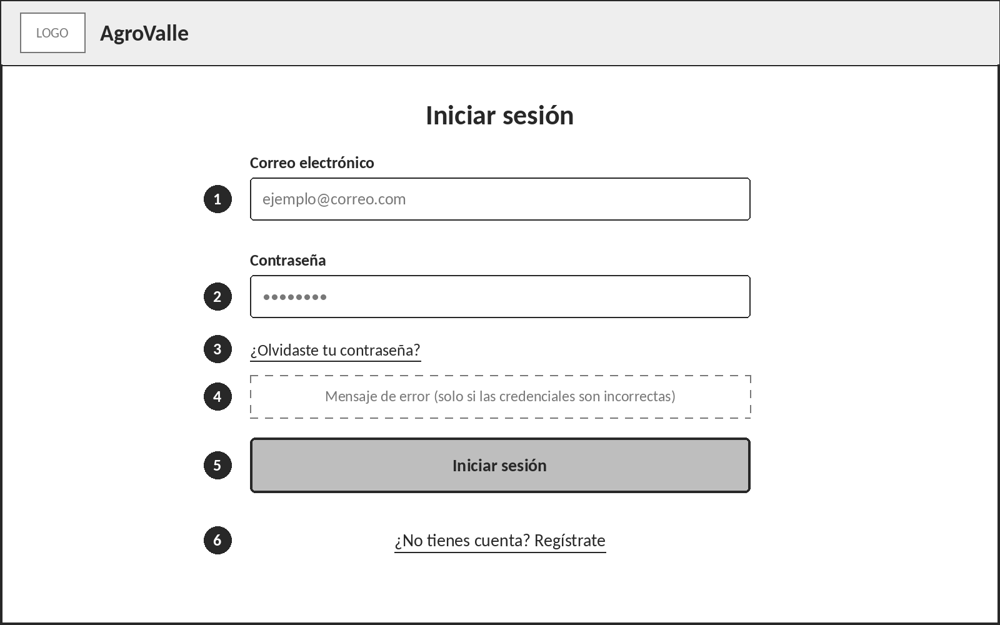
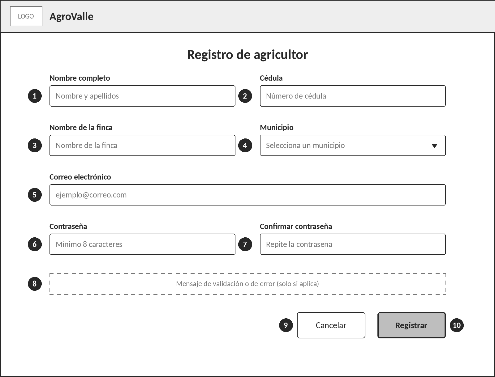
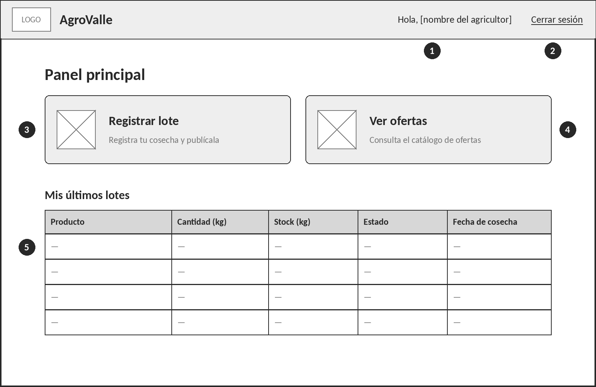
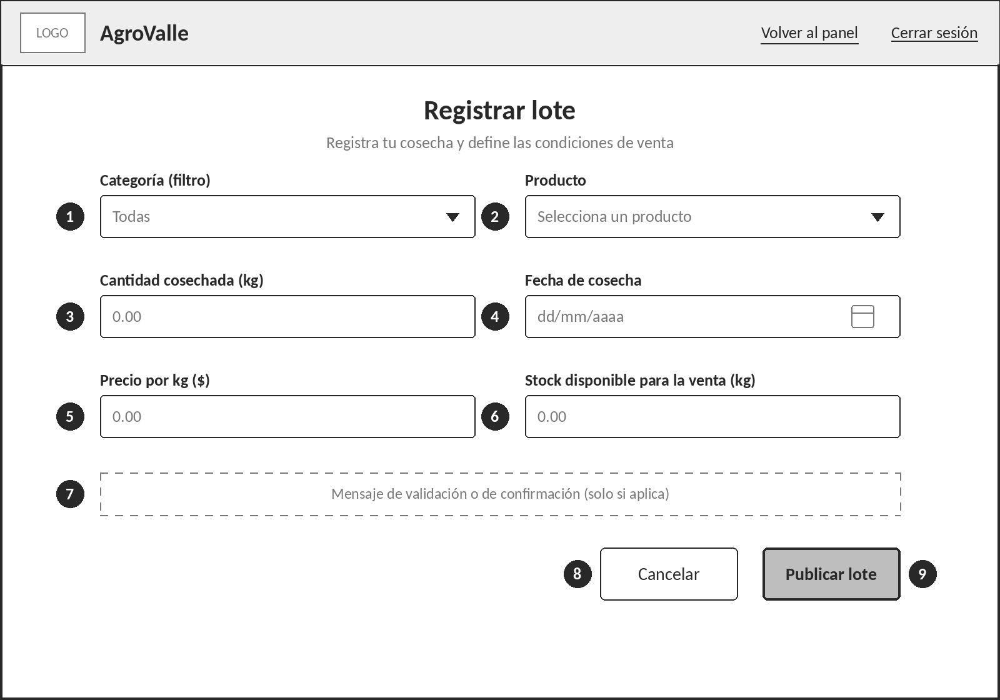

# Wireframes de baja fidelidad — módulo del agricultor

Los mockups originales son propuestas de interacción. Las cinco pantallas del
módulo del agricultor ya cuentan con una interfaz web responsive servida por
Spring Boot; su navegación y alcance se describen en la
[documentación integral](../documentacion-integral-agrovalle.md#3-prototipado-del-módulo-del-agricultor).

## Trazabilidad con historias, API y DTO

| Pantalla / flujo | Historia | API o DTO relacionado | Correspondencia con el backend |
|---|---|---|---|
| Login | HU-11, soporte para HU-02 | `POST /api/v1/auth/login`; `LoginRequest`, `TokenResponse` | Interfaz implementada para agricultores; usa el token JWT y mantiene la sesión en la pestaña actual. |
| Registro de agricultor | HU-01 | `POST /api/v1/agricultores/registro`; `AgricultorRegistroRequest`, `AgricultorResponse` | Interfaz implementada. Valida la cédula de 6–10 dígitos, la confirmación de contraseña y el municipio admitido por el backend. |
| Panel principal | HU-02 | `GET /api/v1/agricultores/{id}/perfil`; `PerfilAgricultorResponse` | Interfaz implementada; muestra el perfil y los lotes activos del agricultor autenticado. |
| Registrar lote | HU-02 | `POST /api/v1/productos`; `LoteCosechaRequest`, `LoteCosechaResponse` | Interfaz implementada con validación y JWT. El nombre de producto es texto libre: el backend no expone un catálogo de productos. |
| Catálogo de ofertas | Evolución del producto | `GET /api/v1/productos/buscar`; `GET /api/v1/agricultores/{id}/perfil` | Interfaz implementada para listar, filtrar y paginar localmente ofertas activas. Los filtros por municipio y categoría consultan el backend; el producto se filtra en la interfaz. |

La aplicación web se encuentra en `src/main/resources/static` y se entrega desde
el mismo servidor Spring Boot, en `http://localhost:8080`. La guía para iniciar
la aplicación está en [INICIO-FACIL.md](../INICIO-FACIL.md).

## Flujo de navegación

## Login

## Registro de agricultor

## Panel principal

## Registrar lote

## Catálogo de ofertas

